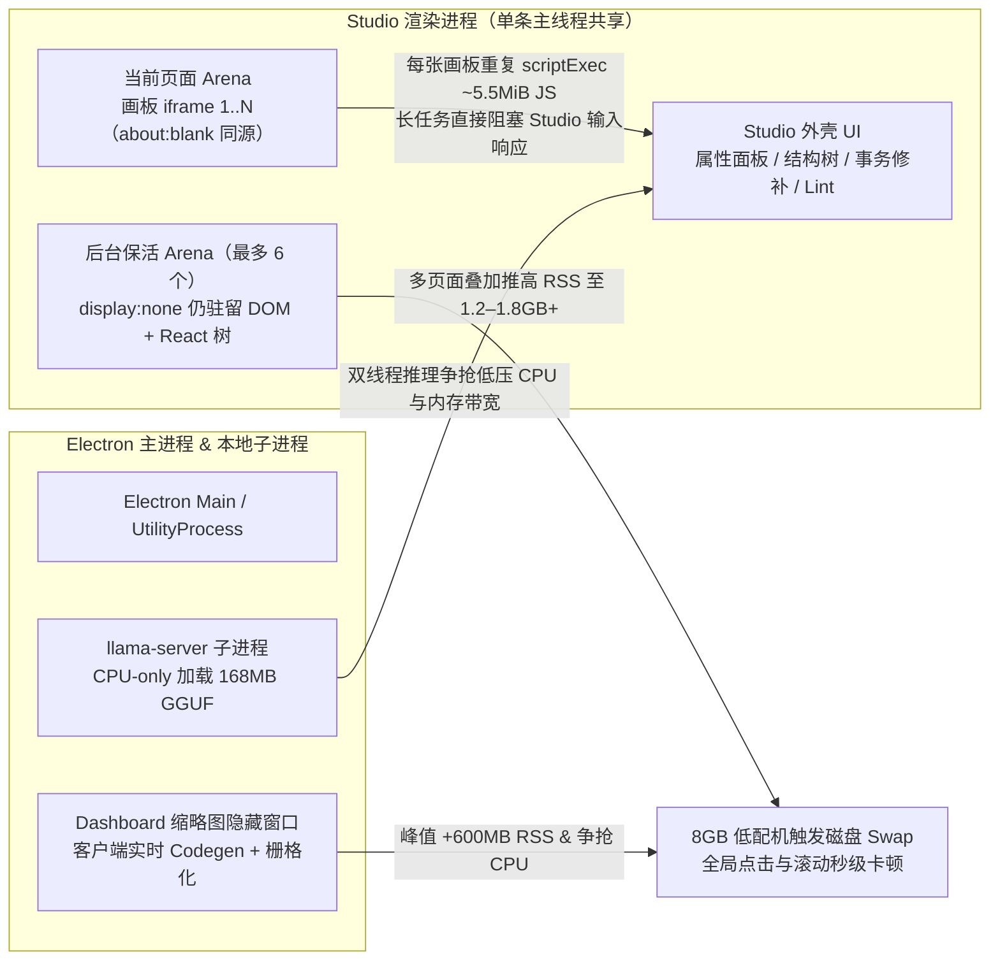
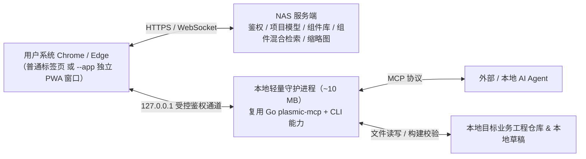

# 桌面客户端框架选型与低配优化方案

更新日期：2026 年 11 月 18 日。状态：架构评估与实施方案。

本文针对当前 Plasmic Desktop（Electron 打包）**安装包体积偏大**与**低配电脑（如 8 GB 内存、Intel/低压核显办公本）运行卡顿**两类问题，基于仓库实测产物与代码事实评估跨端框架选型，并给出分阶段可验收的优化路线。

---

## 一、核心结论与技术路线选型

1. **不建议将主客户端迁移至 Tauri、Wails 等系统 WebView 框架。**
   切换外壳只能省去约 `105 MB`（压缩后）的 Chromium 运行时体积，**无法改变“单渲染进程内同源多画板共享主线程”的执行模型，不能解决低配机卡顿**；同时会引入 macOS `WKWebView`（WebKit）与 Windows `WebView2`（Chromium）跨平台排版差异，破坏视觉设计器“真实网页运行一致性”的核心契约，并导致现有 CDP 截图/PDF、子 Frame 控制与协议缓存体系需要推倒重写。
2. **体积膨胀的首要来源并非 Electron 本身，而是随包内置的本地向量模型与冗余静态产物。**
   当前 `0.9.2` 构建解压后 `Plasmic.app` 共 `640 MB`（安装包 `.dmg` `342 MB`），其中本地组件向量运行时 `component-reuse`（`llama.cpp` + `168 MB` 量化模型 + 重复展开的动态库）单独占去 **`212 MB`**，`renderer/static` 双版本冗余包与主进程原生图形依赖占去 **`168 MB`**。在不更换 Electron 的前提下，通过**端云分离与产物裁剪**即可将 `.dmg` 安装包压降至 **`~115–130 MB`**。
3. **低配机流畅度治理应走「短期硬件自适应降级 + 中期画布执行模型减负 + 轻量 Web 协同形态补充」组合路线：**
   - **主客户端（Electron）**：落地硬件感知的「低配轻量模式（Lite Mode）」止血，推进组件库固定 URL V8 Code Cache、保存态缩略图替代客户端实时渲染，以及具备严格内存回收契约的单活画板机制；
   - **轻量替代形态（Web/PWA + 本地 Go 守护进程）**：面向 8 GB 低配办公设备，复用用户系统已安装的 Chrome/Edge 运行 Web Studio，仅分发一个 **`~10 MB`** 的本地桥接助手（基于现有 Go `plasmic-mcp` 与 `plasmic-cli` 演进）承接本地工程读写与外部 Agent 通信，省去独立 Electron 进程树的常驻内存开销。

### 主流桌面打包框架横向评估

当前 [`desktop/src/`](../desktop/src) 深度依赖以下 Chromium / Electron 原生能力：
- **真实 HTTPS Origin 协议拦截与本地缓存**：[`asset-handler.cjs`](../desktop/src/asset-handler.cjs) 在保留 `studioOrigin` Cookie / CORS / WebSocket 语义的前提下直读本地静态包与 `LibraryCache`；
- **多视图合成与窗口编排**：[`studio-window.cjs`](../desktop/src/studio-window.cjs) 使用 `WebContentsView` 管理工作区、灵动岛（Dynamic Island）及参考浏览器；
- **子 Frame 树遍历与跨 Frame 执行**：[`canvas.cjs`](../desktop/src/canvas.cjs) 通过 `mainFrame.framesInSubtree` 定位画板 `iframe` 执行几何测量与导出；
- **CDP（Chrome DevTools Protocol）深度控制**：[`cdp.cjs`](../desktop/src/cdp.cjs) 驱动无痕整页截图、元素裁剪与原生 PDF 打印；
- **安全与交付基建**：[`package.mjs`](../desktop/scripts/package.mjs) 依赖 Electron Fuses 熔断保护与 `electron-updater` 差分 blockmap 更新。

对照当前主流跨平台桌面框架：

| 框架 / 路线 | 视图内核与宿主 | 空包体积基线 | 低配机卡顿改善效果 | 与当前 Plasmic 架构的适配度与风险 | 选型结论 |
| --- | --- | ---: | --- | --- | --- |
| **Tauri v2** | 系统 WebView（macOS `WKWebView` / Win `WebView2` / Linux `WebKitGTK`）+ Rust | `~8–15 MB` | **基本无改善**（画布仍在单 WebView 线程内执行） | 1. **跨端排版分裂（致命）**：macOS 为 Safari WebKit 内核，字体度量、Flex/Grid 边界、滚动条与 CSS 细节和 Chromium 不一致； 2. **缺少跨端统一 CDP 与子 Frame API**：画布截图、PDF 打印、真实 Origin 拦截难以对等实现； 3. `desktop/src/` 下百余个模块需用 Rust 重写。 | **不采用** |
| **Wails v2 / v3** | 系统 WebView + Go | `~10–15 MB` | **无改善** | 虽可复用 [`desktop/mcp`](../desktop/mcp) 的 Go 技术栈，但视图层与 Tauri 同样受限于 `WKWebView` 兼容性与缺少 CDP 能力。 | **不采用**（仅可用于独立辅助工具） |
| **Electrobun / Neutralinojs** | 系统 WebView（或可选内置 CEF）+ Zig/Bun/C++ | 系统内核 `~12 MB` 内置 CEF `~100 MB+` | **无改善** | 用系统内核同样面临 WebKit 差异；开启内置 CEF 后体积回到 `100 MB+`，而企业级签名、差分更新、崩溃恢复与安全熔断成熟度明显弱于 Electron。 | **不采用** |
| **Flutter / Qt / RN Desktop** | 自绘引擎（Impeller/Skia）或原生控件 | `~20–40 MB` | 外壳流畅，但画布仍需嵌入 WebView | 产品核心契约是**运行团队真实的 React + Antd6 代码组件**（见[产品演进方案](./product-evolution-plan.md)），自绘引擎无法替代真实浏览器 DOM/CSS。 | **路线冲突，不可行** |
| **PWA / Chrome App + 本地 Go 守护进程** | 系统已装 Chrome/Edge + 本地 Go 单二进制 | **`~8–12 MB`** | **显著缓解 8 GB 机器内存压力**（省去独立 Electron 主进程/GPU/网络进程约 `300–400 MB` 固定常驻） | 100% 原生 Chromium 渲染，无需维护第二套前端；本地仅运行轻量守护进程负责 MCP、草稿备份与本地工程读写。受限于浏览器窗口形态，不支持系统级灵动岛悬浮窗与完全离线内置前端包。 | **推荐作为低配机“轻量协同版”补充形态** |
| **Electron 深度瘦身 + 画布分级优化** | 内置固定版本 Chromium + Node.js | **`342 MB` → `~115 MB`** | **配合画布与调度改造可根治** | 跨平台渲染 100% 一致，完整保留 CDP、协议缓存、差分更新及全部原生回归测试资产。 | **主客户端演进路线** |

---

## 二、现状基线与根因拆解

### 2.1 客户端体积实测拆解

基于本机打包产物 `desktop/dist/0.9.2/darwin-arm64`（Electron `45.2.1`）实测：
- 安装包 `Plasmic-0.9.2-mac-arm64.dmg`：**`342 MB`**（`.zip` 更新包 **`338 MB`**）
- 解压后 `Plasmic.app` 总体积：**`640 MB`**

| 目录 / 模块 | 解压体积 | 占比 | 具体构成与膨胀原因（代码事实） |
| --- | ---: | ---: | --- |
| `Contents/Frameworks` | `252 MB` | 39.4% | Electron 与 Chromium 核心框架（压缩进 `.dmg` 后约占 `~105 MB`）。 |
| `Contents/Resources/component-reuse` | **`212 MB`** | **33.1%** | 1. 0.9.2 随包内置 `embeddinggemma-2-UD-Q4_K_XL.gguf`（**`168 MB`**），4-bit 量化权重信息熵高，DMG 压缩率极低，占去安装包近一半下载体积； 2. 脚本 `aliases()` 使用 `dereference: true` 拷贝 `.dylib` 软链接，导致 `libllama-common`（`5.1 MB × 3`）、`libllama`（`3.6 MB × 3`）及纯文本向量未使用的多模态库 `libmtmd`（`1.8 MB × 3`）各生成 3 份实体文件，冗余约 **`24 MB`**； 3. 内置数百个 `4 KB` 预计算 `vector-*.bin` 散文件。 |
| `Contents/Resources/app.asar` | `152 MB` | 23.8% | 1. `desktop/renderer` 共 **`119 MB`**：其中 `static/js` `49 MB`、Monaco Workers 约 `10 MB`（`ts.worker.js` `7.1 MB`）；`static/canvas-packages/build` 占 **`35 MB`**，且存在明显的 v1/v2 双份打包（如 `faker` + `faker-v2` 共 `7.6 MB`，`jquery` 双份 `2.4 MB`，`antd6` 系列 `3.4 MB`，`antd-icons` 双份 `2.0 MB`，`date-fns` 双份 `2.0 MB`，`lodash` 双份 `1.9 MB`）； 2. 主进程 `node_modules` 纯 JS/WASM 依赖（`paper`、`pdf-lib`、`pngjs`、`imagetracerjs` 等，见 [`desktop/package.json`](../desktop/package.json)）约 **`33 MB`**。 |
| `Contents/Resources/app.asar.unpacked` | `16 MB` | 2.5% | 原生图片处理模块 `sharp`（`@img` 平台二进制）。 |
| `Contents/Resources/mcp` | `8.0 MB` | 1.2% | Go 编译的 `plasmic-mcp` 单二进制，体积已高度收敛。 |

### 2.2 低配电脑卡顿与内存压力根因

仓库近期已完成 MobX → Zustand 状态订阅迁移（[迁移记录](./design/mobx-to-zustand-migration.md)）、`FastBundler` 删除节点强引用修复及启动预检并行化（[11-12 复核报告](./performance/2026-11-12/optimization-comparison.md)）。在此基线之上，低配机器（弱单核 CPU、8 GB 物理内存、集成核显）卡顿主要由以下 **4 个结构性因素叠加**造成：

1. **Studio UI 与所有画板共享同一渲染进程、同一条主线程（首要卡顿源）**
   [`CanvasFrame.tsx`](../platform/wab/src/wab/client/components/canvas/CanvasFrame/CanvasFrame.tsx) 通过 `doc.write()` 创建无 `src` 的 `about:blank` 同源 `iframe`，以便同步直接读写父窗口对象。实测表明所有画板与 Studio 外壳运行在同一 `processId` 和单条 V8 主线程上（见 [Intel Mac 深度分析](./performance/2026-10-31/intel-mac-canvas-deep-dive.md)）：低配多核无法分担画布计算，任何画板的 React 渲染、样式重算或 GC 都会直接阻塞属性面板输入、选区拖拽与动画反馈。
2. **每张画板重复解析执行 `~5.5 MiB` 脚本，且内联注入无法复用 URL 级 V8 Code Cache**
   每张画板启动均需加载 `sub`（`1.51 MiB`）并通过 `scriptExec` 内联文本执行 `canvas-packages`（`1.67 MiB`）、`react-web`（`0.21 MiB`）及组件库（Antd6 + Icons 等约 `2.1 MiB`）。10 画板项目在打开阶段需在同一条主线程累计解析执行超 `50 MiB` JS，串行 `requestIdleCallback` 加载期间会持续与用户早期操作抢占主线程。
3. **多 Arena 保活 + 多画板常驻 + 缩略图进程容易击穿 8 GB 物理内存上限**
   - [`devflags.ts`](../platform/wab/src/wab/shared/devflags.ts) 默认 `liveArenas: 6`，切换过的非活动页面仅隐藏视图但完整保留 `iframe`、DOM、React Fiber 与运行时状态；
   - `2026-11-12` 实测（[`canvas-scheduling.json`](./performance/2026-11-12/canvas-scheduling.json)、[`thumbnail-handoff.json`](./performance/2026-11-12/thumbnail-handoff.json)）显示：10 画板项目仅编辑器渲染进程 RSS 即达 `~990–1,020 MiB`，全进程工作集峰值达 `~1.73–1.80 GiB`；若叠加 Dashboard 客户端缩略图渲染（单进程峰值 `~608–631 MiB`），峰值工作集超过 **`2.0 GiB`**。在系统本身已占用 4–5 GB 的 8 GB 机器上会直接触发磁盘 Swap，导致整机卡顿。
4. **本地 CPU 向量推理与编辑期同步计算争抢低压 CPU**
   - [`component-embedding.cjs`](../platform/wab/src/wab/server/component-reuse/component-embedding.cjs) 在本地启动 CPU-only（`--gpu-layers 0`）的 `llama-server` 子进程加载 `168 MB` 模型，在双核/四核低压处理器上会显著争抢内存带宽与 CPU 时间片；
   - 高频编辑路径仍存在主线程同步开销（见[代码级性能瓶颈报告](./performance/2026-11-11/code-bottleneck-analysis.md)）：单节点改色同步重写多张画板未变化的 `<style>` 文本、Issues 面板在渲染期同步执行 `lintSite`、数据选择器全量求值等。

---

## 三、四大优化方向与具体设计

### 方向一：安装包瘦身与重资产端云分离（目标：`.dmg` `342 MB` → `~115–130 MB`）

在不改动 Electron 外壳的前提下，优先剥离高熵大体积资源与构建冗余：

1. **将组件复用检索整体迁至 NAS，App 只缓存候选结果**（预计减少 `212 MB` 解压体积、约 `150 MB` 安装包体积，交付时以重打包实测为准）。
   - **NAS** 按用户有权访问的项目组件目录执行 BM25 关键词检索、Embedding 推理、向量相似度检索和混合排序，一次请求返回按相关性排列的候选组件。公共向量随镜像构建。NAS Web 实例启动时执行一次推理，并把公共契约的 BM25 词频和向量载入内存，全部就绪后才接流量。模型自托管，无需逐次调用外部付费模型。
   - **App** 沿用 Studio 的编辑触发判断。符合条件的编辑先查候选缓存，未命中才请求 NAS。安装包移除 `llama-server`、GGUF 模型和预计算向量，所有设备均由 NAS 维护 BM25 和向量索引。
   - **项目目录** 由桌面 Studio 在项目初次画布就绪时后台同步，契约变动后合并同步，项目发布成功也会立即检查并提交变更。未变化的目录复用已同步版本。仅复用内容匹配的公共索引，组件 UUID、依赖版本及可见范围以当前项目为准。编辑遇到正在同步的新目录时立即返回 `indexing` 和只读复查入口。
   - **候选缓存** 按账号、项目、可见组件目录与检索版本、完整用途文本（`purpose`）区分。缓存 NAS 已排好序、尚未按区域裁剪的候选及其分数和父组件依赖。每次使用时按当前区域已用组件、祖先和会话提示记录筛选，再应用现有候选数量上限。相同用途可跨区域复用，切换账号、目录或检索版本后旧结果失效。仅缓存完整结果（含空结果），索引未就绪或接口超时允许后续重试。
2. **`canvas-packages` 去重与按需化（预计减少 `25–30 MB` 解压体积）**
   - 梳理 `renderer/static/canvas-packages/build` 中的 v1/v2 双份产物（重点清理未被引用的 `faker` 双份 `7.6 MB`、`jquery`、`lodash`、`date-fns` 历史兼容包）；
   - 将低频内置包迁移至现有版本化 [`LibraryCache`](../desktop/README.md#versioned-component-libraries) 机制，随项目实际依赖拉取并跨构建持久化复用，不再全量打入基础 `app.asar`。
3. **主进程依赖与多语言资源收敛（预计减少 `15–25 MB` 解压体积）**
   - 盘点 [`desktop/package.json`](../desktop/package.json) 中 `sharp`（`16 MB` unpacked）、`paper`、`pdf-lib`、`pngjs` 的实际调用点：PDF 已迁移至 Chromium 原生打印（见 [11-12 导出复核](./performance/2026-11-12/followup-comparison.md)），常规位图缩放/裁剪优先使用 Electron `nativeImage` 或浏览器 Canvas，移除不再必需的原生/重型图形库；
   - 在 [`package.mjs`](../desktop/scripts/package.mjs) 的 `electron-builder` 配置中显式声明 `electronLanguages: ["zh-CN", "en-US"]`（macOS / Windows / Linux 同步裁剪多余 Chromium `locales` 语言包）。

#### 一次设计会访问几次 NAS

这里统计用户等待的**前台检索请求**。读取组件契约、截图、预览、手动编辑和纯样式或文案调整均产生 0 次检索。实际编辑可能引入原生控件或自定义功能结构时才进入检查。同一批编辑最多检查 5 个区域，区域共用一个 `purpose`，可用同一份候选。目录稳定、请求成功且无重试时，一次设计的请求数等于通过检查且未命中 App 缓存的不同用途文本数。改写用途、目录变更、缓存失效或显式重试都可能增加次数。组件索引的后台构建单独计量。[Studio 触发与批处理逻辑](../platform/wab/src/wab/client/copilot/component-reuse.ts)

| 设计或测量场景 | 检索量如何估算 |
| --- | --- |
| REQ075 客群列表与 SQL 校验两页主构建 | 脚本共 13 次编辑（建 2 页、建 5 个状态、插入 2 段页面内容、绑定 4 个交互），共用一段用途文本。在同一目录版本下，全部跳过或已有缓存时为 0 次，首次需要候选时合计 1 次。此为按脚本推算，未计后续返工。 |
| 已有本地查询基准 | 32 次查询使用 10 种用途，实测 10 次推理、22 次查询向量缓存命中。用相同输入回放新方案，若候选缓存初始为空、版本稳定且请求均成功，预计访问 NAS 10 次。 |
| 用途频繁变化的长设计 | 若有 30 段不同的用途通过检查且均未缓存，预计访问 NAS 30 次。此行用于估算高调用量场景。 |

REQ075 只覆盖两个具体模块，32 次查询来自检索基准。真实设计的平均调用次数仍需通过 MCP 编辑回放测量。[本地检索测量说明](./design/component-reuse-implementation/README.md)

#### 接口延迟会增加多少设计时间

当前 MCP 编辑在提交成功后等待复用检查返回，检查共享 5 秒预算。已有 M4 本地基准中，模型已启动时 41 条检索样本的中位数约为 31 ms，模型冷启动后的首条查询约为 450 ms。下表取 **30 ms** 作本地热查询基线，假设请求串行、目录已就绪，每次 NAS 端到端耗时包含网络、排队、推理和排序。**相对当前方案的额外等待 ≈ 实际联网次数 ×（NAS 单次端到端耗时 − 30 ms）**。表中为情景估算，实测对照见下表。[编辑等待逻辑](../platform/wab/src/wab/client/copilot/index.ts) · [本地原始数据](./design/component-reuse-implementation/native-final.json)

| 前台联网次数 | NAS 每次 100 ms | NAS 每次 200 ms | NAS 每次 500 ms | NAS 每次 1 s |
| ---: | ---: | ---: | ---: | ---: |
| 1 | +0.07 秒 | +0.17 秒 | +0.47 秒 | +0.97 秒 |
| 10 | +0.7 秒 | +1.7 秒 | +4.7 秒 | +9.7 秒 |
| 30 | +2.1 秒 | +5.1 秒 | +14.1 秒 | +29.1 秒 |

若一次设计有 10 次未命中，接口每次 200 ms，累计联网等待约 2 秒，较本地热查询多约 1.7 秒。若 30 次请求均需 1 秒，累计多等约 29 秒，且每次工具返回都有可感知的停顿。命中 App 缓存时联网等待为零。接近 5 秒预算的请求还可能使该次检查超时，应保留已提交的设计编辑。

#### NAS 实机回放结果（2026-11-18）

每轮在两个页面各执行 1 次建页、4 次功能控件插入、1 次文案插入，共 12 次。8 次触发检查，覆盖标签切换、分页表格、滑出编辑面板 3 种用途。各组使用同一套 126 个公共组件契约。首次运行的候选缓存为空，第二轮保留同一目录和用途的候选缓存。

| 每轮 12 次编辑 | 本地版 | NAS 按需启动 | NAS 提前准备 | 提前准备后的前台检索 / 编辑期间目录同步 |
| --- | ---: | ---: | ---: | ---: | ---: |
| 首轮编辑总耗时 | 811 ms | 2,765 ms | **567 ms** | 3 / 0 次 |
| 缓存命中后编辑总耗时 | 75 ms | 73 ms | **70 ms** | 0 / 0 次 |

- **NAS 上线准备**用时 1,804 ms，包含启动模型、一次预热推理、读取公共向量和准备公共 BM25 词频。每个新实例承担一次，预热完成后开放监听。
- **项目打开**时后台同步 1 次，用时 200 ms。测试在这次同步自然完成后开始编辑。从测试项目初始化到首轮 12 次编辑全部返回共 **831 ms**，其中编辑占 567 ms。缓存轮无目录请求，从初始化到结束为 87 ms。
- **实际编辑**中 3 次检索往返分别为 149、128、130 ms，其余 5 次检查命中 App 缓存。未发生重试，两轮每一步的候选和顺序均与原 NAS 回放一致。目录同步与首条编辑重叠时，编辑返回准备中状态，只读复查可以取得建议；该分支另有回归测试。
- 上一版首轮的 691 ms 目录同步和含启动的 1,623 ms 首条检索都落在编辑等待内，因此当时记录为实际等待。提前准备后，首轮编辑少等约 2.20 秒。此次为单组回放，不用于估算线上 P95。

NAS 为 Intel Pentium Gold 8505，测试容器限 2 核，Mac 通过双向 TLS 私网连接访问。回放含真实 Studio 编辑工具和相同的测试桥接开销，未覆盖 Electron 渲染、生产网关、项目权限数据库查询、Agent 思考或保存。REQ075 的 13 次编辑仍为脚本估算。[逐操作计时及候选](./performance/2026-11-18/component-search-replay.json) · [回放操作](../platform/wab/src/wab/client/copilot/component-search-replay.test.ts)

#### Material UI 首轮回放（2026-11-18）

NAS 镜像构建从本次发布的公共组件库包读取实际注册契约。四个库共 239 个组件，生成 602 个不同的向量分片。Material UI 占 104 个组件、321 个分片。后续随 NAS 发布的公共工作区组件库使用同一个构建入口。实机测试使用 104 个 Material UI 契约作为项目目录，重放上节相同的 12 次编辑。

| 计时范围 | NAS 请求 | 实测耗时 |
| --- | --- | ---: |
| NAS 实例接流量前预热公共索引和模型 | 0 次客户端请求 | 1,750 ms |
| 首次打开项目时同步目录 | 1 次目录同步，104/104 已就绪 | 328 ms |
| 第一条编辑（建页） | 0 次检索 | 21 ms |
| 第一条触发检查的功能编辑（标签切换） | 1 次检索，往返 189 ms | 224 ms |
| 首轮 12 次编辑 | 3 次检索，0 次目录同步，5 次候选缓存命中 | **633 ms** |
| 相同目录和用途再次执行 12 次编辑 | 0 次检索，0 次目录同步，8 次候选缓存命中 | **81 ms** |

从测试项目初始化到首轮全部编辑返回共 **1,025 ms**。首轮另外两次检索往返分别为 141 ms 和 119 ms。两轮均完成 8 次检查，其余 4 次跳过。标签切换、分页表格分别返回 Tabs 和 Table；“从右侧滑出编辑客户详情”返回 Slider，未命中 Drawer。上节原 126 个组件的预热回放为 567 ms，本组为 633 ms，两次单轮样本相差 66 ms。计时边界及网络条件与上节相同。[Material UI 逐操作结果](./performance/2026-11-18/material-ui-component-search-replay.json)

**Material UI 候选质量复测。** 补充 Drawer、SwipeableDrawer 和 Slider 的用途描述后，在同一台双核限额 NAS 上，以相同模型、完整 104 个契约和 8 条固定查询对照，首选命中由 5/8 提升到 8/8。原英文滑出编辑查询从仅返回 Slider 变为依次返回 Drawer、Slider；另一种英文侧边编辑表述和中文“从右侧滑出面板，编辑客户资料”也均首选 Drawer。单值和范围输入仍首选 Slider，边缘滑动导航首选 SwipeableDrawer，标签与分页表格保持正确。这是检索质量对照，上表耗时来自此前的设计操作回放。[可复现的原生模型回归用例](../desktop/tests/performance/material-ui-retrieval.test.cjs)

**侧边编辑面板的次选误召回。** 对原英文查询，Slider 的 BM25 得分为 0，用途描述余弦为 0.6522，包含 `marks`、`min/max`、`onChange` 的属性片段却达到 0.6819，超过原有的 0.68 准入线。Drawer 的用途描述达到 0.7098。现在，当另一个组件的用途描述比次选的最佳片段更匹配时，已有描述的次选需要命中有区分度的查询词，或由自身用途描述通过语义门槛。相同 NAS 上重跑全部 8 条查询，原英文编辑查询仅返回 Drawer；8 条查询的首选均正确，音量和双端价格范围查询的完整候选及顺序与改前相同。[逐项对照与原始片段得分](./performance/2026-11-18/material-ui-secondary-candidates.json)

### 方向二：硬件感知的「低配轻量模式（Lite Mode）」（短期最快止血）

针对低配设备单核弱、内存小的物理限制，引入集中式运行档位策略（支持**启动自动识别 + 设置页手动切换**）：

- **自动触发条件（满足任一默认开启，用户可覆盖）**：
  - 物理内存 `os.totalmem() <= 8 GiB`；
  - `process.arch === "x64"` 的旧款 Intel Mac，或逻辑核心数 `<= 4`；
  - 运行期连续监测到主线程长任务阻塞（如编辑交互长帧 > `300 ms` 频繁出现）时提示一键开启。
- **轻量模式具体策略（不改变任何业务文档模型与保存结果）**：
  1. **收紧 Arena 保活上限**：将运行时 `liveArenas` 从 `6` 下调为 **`1`**（切换页面后立即卸载切走页面的隐藏 `iframe` 与 `ViewCtx`，仅保留内存中的站点数据模型，切断多页面内存累加链）；
  2. **按需激活画板（关闭后台全量预热）**：打开多画板页面时仅加载当前聚焦/主视口的 **1 张画板**，暂停后台 `requestIdleCallback` 串行加载其余画板的队列；未加载画板展示轻量尺寸占位框与标题，点击或滚入视口中心时再启动加载；
  3. **停用客户端后台重任务**：关闭客户端本地隐藏窗口缩略图生成；
  4. **降低合成层与重绘开销**：关闭画板加载骨架屏的持续循环动画、编辑器外壳大面积 `backdrop-filter` 毛玻璃及高频悬浮过渡动画，减轻集成核显在 2x Retina 屏幕下的 GPU 合成负担。

### 方向三：画布执行模型与编辑器主线程减负（中期治本）

1. **以固定协议 URL `<script src>` 替代 `scriptExec` 内联注入，启用 V8 Code Cache**
   - 当前画板通过 `scriptExec` 将数兆字节的 `canvas-packages` 与组件库源码作为内联字符串注入 `about:blank` `iframe`，每次新建画板都必须在主线程重新执行源码解析与编译；
   - 改造路径：将内置运行时与不可变版本组件库映射为受控协议下的固定版本 URL（开启自定义协议的 `codeCache: true`），在画板文档内通过标准 `<script src="...">` 引用。首张画板完成编译后，同会话及后续冷启动画板可直接命中 Chromium V8 字节码缓存，显著压缩多画板 CPU 解析时间。
2. **「单活画板 + 静态总览快照」的生产化闭环**
   - `2026-11-12` 原型实验（[`static-overview-prototype.json`](./performance/2026-11-12/static-overview-prototype.json)）已验证：在已有快照前提下，10 画板总览就绪耗时可从 `~4.0 s` 降至 `~1.7–2.0 s`，编辑器初始 RSS 从 `~829 MiB` 降至 `~656 MiB`；但该实验同时暴露了两个上线前提——**缺少生产级快照来源**，以及**反复切换激活画板后若旧 `iframe` 未彻底回收会抵消内存收益，且冷态提升为可编辑画板需 `~420–570 ms`**。
   - 因此正式方案必须按以下闭环推进，不单独上线半成品：
     1. **快照生产**：在画板完成渲染且模型保存时，利用现有视口截图链路生成与 `(projectId, revision, artboardId)` 绑定的轻量本地/服务端缓存快照；
     2. **严格容量上限（LRU = 1~2）与确定性卸载**：同一时刻最多保留 1–2 个活动交互 `iframe`；画板退回静态态时必须同步更新最新快照并彻底销毁原 `iframe` DOM、`ViewCtx` 与 `CanvasRenderOwner` 订阅，通过连续切换 20 次无净内存增长的原生回归验证后再默认开启。
3. **项目缩略图彻底迁出客户端实时渲染链路**
   - 对齐[产品演进方案](./product-evolution-plan.md)要求，项目卡片缩略图统一采用**保存/发布时由已打开画布顺带截取上传（或服务端异步生成）**的缓存图片；缩略图缺失时直接显示轻量静态占位，彻底下线客户端进入列表页后后台启动隐藏画布执行 codegen + 渲染栅格化的路径。
4. **高频编辑同步路径治理**
   - **样式同步去重**：在 [`style-mgr.ts`](../platform/wab/src/wab/client/style-mgr.ts) 写入画板 `<style>` 节点前比对样式版本号/内容摘要，跳过未变更组件的重复 `textContent` 重写与 DOM 重挂，避免单节点改色触发多张画板全量 CSS 重解析；
   - **Lint 与数据搜索异步/Worker 化**：将 Issues 面板渲染期同步调用的 `lintSite` 改为编辑提交后防抖异步调度（或移入 Worker），并对 DataPicker 长列表与搜索结果引入视口虚拟化及惰性求值。

### 方向四：双形态交付 ——「Web/PWA + ~10 MB 本地桥接守护进程」

对于硬件受限（8 GB 办公本）或以评审、微调、连接本地工程为主的用户，无需在已运行 Chrome/Edge 的基础上再常驻一套完整的 Electron 实例：

- **职责划分**：
  - **界面与画布**：直接运行在用户系统 Chrome/Edge（支持一键安装为无地址栏桌面 PWA），100% 保持 Chromium 渲染一致性，直接共享系统浏览器已常驻的 GPU 进程、网络栈与磁盘缓存；
  - **本地能力桥接**：将现有 Go 编写的 [`desktop/mcp`](../desktop/mcp)（仅 `8 MB`）扩展为带最小系统托盘状态的本地守护进程，承接外部 Agent MCP 连接、本地业务仓库代码交付读写与本地防丢草稿落盘。
- **工程边界**：与完整 Electron Desktop 共用同一套 Studio 前端产物、同一套 MCP 工具契约与权限校验，**不维护第二套前端代码**。需要灵动岛多窗口协同、离线内置静态包和深度无痕截图的用户继续使用标准 Electron 客户端；低配机用户可直接使用「浏览器 + 本地小助手」轻装运行。

---

## 四、分阶段实施路线与验收门槛

按**“风险最低、体感改善最快优先”**原则分三阶段推进，每阶段均须通过自动化回归与真实基准复测：

| 阶段 | 核心任务 | 关键交付物 | 量化验收条件 |
| --- | --- | --- | --- |
| **P0：包体减重与低配止血** | 1. 将 BM25、Embedding、向量检索和混排迁至 NAS，App 只缓存候选并移除本地检索运行时； 2. 清理 `canvas-packages` 双版本死包、配置 `electronLanguages`； 3. 上线硬件感知「低配轻量模式（Lite Mode）」（`liveArenas=1` + 画板点击按需加载 + 禁后台重任务）； 4. 修复 `style-mgr` 未变更样式表重复写入。 | 瘦身版安装包、Lite Mode 策略开关与状态提示、样式同步去重补丁 | 1. macOS `.dmg` 安装包由 `342 MB` 降至 **`<= 135 MB`**，解压体积由 `640 MB` 降至 **`<= 330 MB`**； 2. Lite Mode 下打开 10 画板项目并连续切换 5 个页面，编辑器进程 RSS 稳定且较默认模式下降显著，无未加载画板抢占主线程； 3. 打包签名、组件复用检索与样式编辑回归通过，完成方向一的本地与 NAS 对照回放并提交调用次数和耗时结果。 |
| **P1：执行模型与缩略图治本** | 1. 保存/发布时生成并上传项目封面缩略图，默认下线客户端 Dashboard 隐藏画布渲染； 2. 组件库与 `canvas-packages` 改为受控协议固定 URL `<script src>` 加载并开启 V8 Code Cache； 3. Issues 面板 `lintSite` 脱离渲染同步路径，DataPicker 增加虚拟列表（复用共享 `Scrollbar`）。 | 保存态缩略图链路、协议级字节码缓存加载器、异步 Lint 与虚拟化选择器 | 1. 项目列表打开至进入编辑器全流程消除约 `600 MB` 的缩略图渲染进程内存峰值； 2. 同会话第 2..N 张画板脚本执行耗时较 `scriptExec` 基线可测下降； 3. 1,000 节点样本下打开 Issues 面板单次样式编辑主线程阻塞显著降低，滚动容器符合共享 `Scrollbar` 规范。 |
| **P2：单活画板闭环与轻量守护进程形态** | 1. 基于保存态快照与确定性 `iframe` 卸载实现「静态总览 + 单活/双活画板」； 2. 封装 `~10 MB` 独立本地桥接助手，打通 Chrome/PWA Studio 连接本地 MCP 与工程交付。 | 生产级分级画布渲染器、独立本地助手安装包与连接引导 | 1. 10 画板项目连续交互切换激活画板 20 轮无内存泄漏，总览就绪耗时与常驻内存优于全活基线，且选区、截图、MCP 定位一致； 2. 8 GB 测试设备通过「Chrome PWA + 本地助手」完成完整业务页面创建、预览、保存与工程代码交付验收。 |

---

## 五、暂不投入项与边界约束

1. **不启动向 Tauri / Wails / Flutter 的整体客户端重写**：避免在无法改善画布单线程根因的前提下承担跨内核排版不一致与高昂迁移成本。
2. **不重写自研画布渲染引擎（如 Canvas/WebGL 自绘替代 DOM）**：Plasmic 的核心竞争力是直接运行业务团队真实的 React/Antd 组件并验证真实交互，必须保留浏览器 DOM/CSS 运行环境。
3. **临时降级态绝不污染业务模型**：Lite Mode 下的未激活画板占位、动画关闭、单页保活卸载均只属于当前客户端会话视图态，不得改写项目保存后的默认业务属性、组件契约或导出代码。
4. **滚动容器一致性**：DataPicker、列表虚拟化等所有新增或调整的 UI 滚动区域必须复用仓库共享 `Scrollbar` 组件，禁止裸写原生 `overflow: auto/scroll`。

---

## 六、代码与实测依据索引

- 打包与产物构建：[`desktop/package.json`](../desktop/package.json)、[`desktop/scripts/package.mjs`](../desktop/scripts/package.mjs)、[NAS 模型准备](../deploy/component-search/prepare-model.mjs)
- 检索服务与桌面核心模块：[`component-embedding.cjs`](../platform/wab/src/wab/server/component-reuse/component-embedding.cjs)、[`component-reuse.cjs`](../platform/wab/src/wab/server/component-reuse/component-reuse.cjs)、[`desktop/src/asset-handler.cjs`](../desktop/src/asset-handler.cjs)、[`desktop/src/canvas.cjs`](../desktop/src/canvas.cjs)、[`desktop/src/cdp.cjs`](../desktop/src/cdp.cjs)、[`desktop/src/studio-window.cjs`](../desktop/src/studio-window.cjs)
- 画布与编辑器运行模型：[`CanvasFrame.tsx`](../platform/wab/src/wab/client/components/canvas/CanvasFrame/CanvasFrame.tsx)、[`StudioCtx.tsx`](../platform/wab/src/wab/client/studio-ctx/StudioCtx.tsx)、[`devflags.ts`](../platform/wab/src/wab/shared/devflags.ts)
- 既有性能实测与演进规划：
  - [Plasmic 产品演进方案](./product-evolution-plan.md)
  - [Studio 原生状态与模型订阅（MobX → Zustand）](./design/mobx-to-zustand-migration.md)
  - [Intel Mac 卡顿与画布加载慢：架构级深度分析](./performance/2026-10-31/intel-mac-canvas-deep-dive.md)
  - [代码级性能瓶颈分析报告](./performance/2026-11-11/code-bottleneck-analysis.md)
  - [Studio 加载、内存与渲染复核](./performance/2026-11-12/optimization-comparison.md) 与 [编辑、项目列表与导出复核](./performance/2026-11-12/followup-comparison.md)
  - [静态总览原型对比数据](./performance/2026-11-12/static-overview-prototype.json) 与 [缩略图生命周期对比数据](./performance/2026-11-12/thumbnail-handoff.json)
