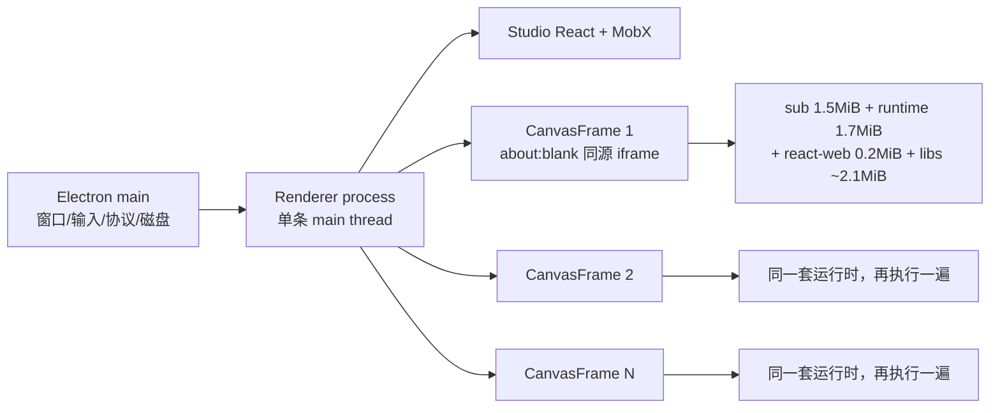

# Intel Mac 卡顿与画布加载慢：架构级深度分析

日期：2026-10-31（Asia/Shanghai）  
分析对象：Plasmic Desktop（Electron 44 / Chromium 152）与 `platform/wab` Studio 画布  
代码基线：当前工作区（`390772252` 之后的未提交修改）  
分析环境：Apple M4 / 24GB / macOS 26.6。**本机不是 Intel，不能把本机耗时当作 Intel 实测**；本文把“本机实测”“仓库已有实测”“代码事实”“待真机验证”分开标注。

---

## 0. 结论（先看这里）

1. **画布慢的第一原因不是 Electron，而是画布执行模型：每个画板是一个同源 `<iframe>`，和 Studio 在同一个渲染进程、同一条主线程上。** 本机用 Electron 做了最小验证：iframe 与主页面 `processId` 相同；在 iframe 里跑 400ms 同步循环，主页面的 50ms 定时器被推迟到 **401ms** 才执行。画布里的 JS、React 渲染、样式/布局全部直接阻塞 Studio UI，Intel 的多核帮不上忙。
2. **每个画板都会重新执行一整套画布运行时和组件库。** 以当前构建和本项目依赖估算：`sub` 1.51MiB + canvas runtime 1.67MiB + react-web 0.21MiB + 四个组件库约 2.11MiB，合计 **约 5.5MiB JS/画板**。3 个画板约 16.5MiB，6 个约 33MiB；而且组件库是通过 `scriptExec` 以内联文本注入，拿不到基于 URL 的 V8 code cache。
3. **画板是串行加载的，而且每次只在一个 `requestIdleCallback` 里启动下一个。** 首屏只等当前画板，剩余画板在“后台”继续加载；用户一开始操作，这些加载就会和输入抢同一条主线程。加载中的骨架屏还是 `active` 动画，持续重绘。
4. **Studio 最多保活 6 个 arena（`liveArenas: 6`）。** 非当前 arena 只是 `display:none`，里面的所有画板 iframe、React 树、Val 树、运行时都还在。访问页面越多，内存越高；8GB Intel 很容易进入 swap，之后连点击都会卡。
5. **项目列表的画布缩略图默认开启，是独立的第二个大热点。** 仓库实测（Apple Silicon）：4 张可见卡片生成耗时 **25.7–30.3 秒**，渲染进程 RSS 峰值 **1.2–1.6GB**。Intel 上更慢、更热，且会与编辑器/画布抢 CPU。这个功能在本仓库被 `devflag-overrides.ts` 默认打开。
6. **不建议为此换 Tauri/PWA。** 当前产品依赖 Blink 排版一致性、CDP、MCP、画布截图/离屏渲染、Monaco worker；换壳不会消除上面的画布模型问题，只会增加迁移风险。**应先做“Intel/低内存模式 + 画板懒加载/单活画板 + 减少每帧重复执行 + 缩略图服务端化”的渐进优化。**

最可能的主因排序（置信度）：

| 排序 | 问题 | 置信度 | 说明 |
| --- | --- | --- | --- |
| 1 | 画布与 Studio 同进程同线程；每画板重复执行约 5.5MiB JS | 高（代码 + 本机实测） | 直接解释“加载慢 + 输入卡” |
| 2 | 多画板串行加载 + 后台 idle 加载 + 动画骨架 | 高（代码事实） | 直接解释“打开后持续几秒卡” |
| 3 | 6 个 arena 保活导致隐藏 iframe/React 树常驻 | 高（代码事实），内存量待测 | 解释“用久了越来越卡/8GB swap” |
| 4 | 列表缩略图 25–30s / 1.2–1.6GB | 高（仓库 Apple Silicon 实测） | 解释“列表也卡、整机发热” |
| 5 | Intel 单核弱 + iGPU/2x DPR + 热降频 + swap | 中（需真机） | 放大以上所有问题 |
| 6 | 自定义 Host 项目每个画板重复拉取 Host HTML/资源 | 中（代码事实，取决于项目） | 自定义 host 用户会明显更慢 |

---

## 1. 证据边界

| 等级 | 内容 | 在哪里 |
| --- | --- | --- |
| 本机实测 | iframe 与主页面同 `processId`；iframe 400ms 循环阻塞主页面 401ms；空白 Host 首帧 +34MB RSS，后续每帧约 +6–10MB | 本文 §2.1 |
| 本机实测 | 初始 18 个脚本 4.43MiB（gzip 1.23MiB）；每帧 `sub`/runtime/react-web/四库合计 5.51MiB | 本文 §2.3 |
| 仓库已有实测（Apple Silicon） | App 暖开 2.33s、冷开 3.60s、Web 冷开 8.28s；首帧 249–270ms；组件库阶段 39ms 暖/687ms 冷 | [canvas-startup-current.md](canvas-startup-current.md) |
| 仓库已有实测（Apple Silicon） | 4 张缩略图 25.7–30.3s；RSS 峰值 1.2–1.6GB | [intel-mac-latency-review.md](../2026-10-29/intel-mac-latency-review.md) |
| 仓库已有实测（Apple Silicon） | 项目响应 6.16MB，其中依赖模型 5.90MB（95.7%） | [canvas-model-breakdown.json](../2026-10-30/canvas-model-breakdown.json) |
| 代码事实 | 每画板一个 iframe；串行队列；`liveArenas: 6`；缩略图默认开启；自定义 Host 不缓存 HTML | 本文 §3 |
| 待 Intel 真机 | 实际单核耗时、GPU feature status、swap、热降频、每帧 JS heap | 本文 §10 |

> 本文不会把“iframe 上下文”直接等同于“独立进程/独立 V8 堆”，也不会给出未经测量的“内存减半/提速 2–3 倍”承诺。

---

## 2. 当前运行模型

### 2.1 进程/线程：画布和 Studio 共享一条主线程

画布 iframe 没有 `src`，由 Studio 通过 `doc.open()/doc.write()` 写入 Host HTML（[CanvasFrame.tsx](../../../platform/wab/src/wab/client/components/canvas/CanvasFrame/CanvasFrame.tsx#L443)）。这种 `about:blank` iframe **继承父页面 origin**，因此：

- 画布代码可以直接访问父页面对象（`__Sub`、React、`studioCtx` 等），不需要 postMessage/序列化；
- 代价是 iframe 与 Studio **同一个 renderer process、同一条 main thread**。

本机用 Electron 44 做了最小验证（同一个 `BrowserWindow`，一个无 `src` 的 iframe）：

```text
frames: [主页面 pid=4, about:blank iframe pid=4]
主页面 50ms 定时器，在 iframe 内执行 400ms 同步循环后：
  parent timer delay = 401ms
```

结论：**画布里的任何长任务，都会直接推迟 Studio 的输入、动画、点击反馈。** Intel 的 4 核/6 核不会让画布变快，因为画布 JS 不会并行到其他核。

> 这是机制验证，不是真实画布耗时：测试用的是普通同源 iframe，不是完整项目。真实 `CanvasFrame` 同样是无 `src`、由父页面写入的 about:blank iframe，因此进程/线程结论相同。空白 Host 的 RSS 实测为：首个 iframe +34MB，后续每个约 +6–10MB（`--disable-gpu`，Apple Silicon）；它只能作为“每帧有固定成本”的下界，不能代表真实项目。



### 2.2 一次画布打开的链路

```text
点击项目/页面
  → Studio 入口 HTML + 18 个初始脚本（4.43MiB）
  → project GET（暖缓存 0.13–0.18s；6.16MB，95.7% 是依赖模型）
  → unbundleSite + MobX 包装（64–84ms，Apple Silicon）
  → 首帧 CanvasFrame：
       fetch Host HTML（内置 Host 只取一次）
       doc.write(host.html)
       加载 sub 1.5MiB
       ensureCanvasRuntime → scriptExec(canvas runtime 1.7MiB)
       scriptExec(react-web 0.2MiB)
       scriptExec(各组件库 ~2.1MiB)
       React 首次渲染 249–270ms
  → 其余画板：串行队列 + requestIdleCallback，逐个重复上面的步骤
  → 骨架屏 active 动画持续到各自首帧完成
```

### 2.3 关键数字

初始入口（`desktop/renderer/index.html`，与 `platform/wab/build` 一致）：

| 项目 | 值 |
| --- | ---: |
| 初始 `<script>` 数 | 18 |
| 初始 JS 原始大小 | 4.43 MiB |
| 初始 JS gzip | 1.23 MiB |
| 最大单 chunk | 1005 KiB |

每个画板 iframe（当前构建 + 本项目实际依赖）：

| 资源 | 大小 | 注入方式 |
| --- | ---: | --- |
| `sub/build/client.<hash>.js` | 1.51 MiB | Host HTML `<script src>` |
| `canvas-packages/build/client.js` | 1.67 MiB | `scriptExec` 内联文本 |
| `react-web-bundle` | 0.21 MiB | `scriptExec` 内联文本 |
| Antd6 | 0.92 MiB | `scriptExec` 内联文本 |
| Antd Icons | 1.03 MiB | `scriptExec` 内联文本 |
| React UI | 0.13 MiB | `scriptExec` 内联文本 |
| Overseas | 0.03 MiB | `scriptExec` 内联文本 |
| **合计** | **5.51 MiB/画板** | |

3 个画板约 **16.5 MiB**，6 个约 **33.1 MiB** 的 JS 需要在同一线程上解析/执行（实际还可能有 Admin Templates 等库，未计入）。

已有 Apple Silicon 实测的分段耗时（暖开，中位数）：

| 阶段 | 耗时 | 说明 |
| --- | ---: | --- |
| 导航到 Studio 内部计时起点 | 1.15s | 入口、预取、Host、前置脚本 |
| project GET | 0.13–0.18s | 暖缓存 |
| Studio 模块导入 | 0.10s | 入口模块执行 |
| 模型解包 | 0.06–0.08s | 6.16MB |
| 首帧 Host 文档 | 0.08s | |
| 首帧 runtime | 0.009s | 暖缓存 |
| 首帧组件库 | 0.039s | 暖缓存 |
| 首帧渲染 | 0.25s | |
| **可编辑** | **2.33s** | 冷开 3.60s；Web 冷开 8.28s |

> 这些是 Apple Silicon 数字。Intel 单核通常明显弱于 M4；按 1.5–2.5 倍单核差距粗略外推，暖开约 **3.5–5.8s**，冷开更久。这个区间只是量级判断，不是 Intel 实测。

---

## 3. 根因拆解

### R1（高）画布与 Studio 共享 main thread

- 机制：同源 `about:blank` iframe + 直接对象共享，决定了同进程同线程。
- 证据：本机实测 pid 相同、400ms 循环阻塞父页面 401ms（§2.1）。
- 影响：所有画布 JS、React commit、样式计算、布局、部分绘制都会阻塞 Studio 输入；Intel 多核无法分担。
- 备注：这不是“Electron 慢”，而是当前画布的隔离/共享取舍。

### R2（高）每个画板重复执行约 5.5MiB 运行时和组件库

- 机制：`ensureCanvasRuntime()` 对每个 `win` 执行一次 runtime；`getSortedHostLessPkgs()` 返回源码，`canvas-ctx.ts` 对每个 frame 执行 `scriptExec(this._win, pkgModule)`。
- 代码：[canvas-ctx.ts#L324](../../../platform/wab/src/wab/client/components/canvas/canvas-ctx.ts#L324)、[canvas-ctx.ts#L146](../../../platform/wab/src/wab/client/components/canvas/canvas-ctx.ts#L146)、[studio-bundles.ts#L82](../../../platform/wab/src/wab/client/components/studio/studio-bundles.ts#L82)。
- 影响：画板数线性放大 CPU 和内存；组件库越大（Antd Icons 1.03MiB）越明显。
- 额外问题：runtime/react-web/库都是 `scriptExec` 内联文本，**无法利用基于资源 URL 的 V8 code cache**；每次新 frame 都要重新解析/编译。

### R3（高）画板串行加载 + idle 调度 + 动画骨架

- 机制：`queueCanvasFrame` 把请求放进队列，一次只加载一个；每个加载完成后 `requestIdleCallbackAsync(loadNext)`（[StudioCtx.tsx#L8448](../../../platform/wab/src/wab/client/studio-ctx/StudioCtx.tsx#L8448)、[#L8538](../../../platform/wab/src/wab/client/studio-ctx/StudioCtx.tsx#L8538)）。没有“用户正在输入就暂停”的优先级。
- 影响：N 个画板的墙钟时间 ≈ N × 单帧启动时间；首批之后用户开始操作，后台仍会继续启动下一个画板，和输入抢主线程。
- 骨架：`<Skeleton active paragraph={{ rows: 5 }} />`（[CanvasFrame.tsx#L698](../../../platform/wab/src/wab/client/components/canvas/CanvasFrame/CanvasFrame.tsx#L698)）在排队/加载期间持续动画；多个画板同时排队时，多个 shimmer 在主线程重绘。
- 触发面：页面矩阵的每个 cell 都是一个 `CanvasFrame`（[GridFramesLayout.tsx#L62](../../../platform/wab/src/wab/client/components/studio/arenas/GridFramesLayout.tsx#L62)）；组件的变体组合、自定义 Combinations 会进一步放大画板数。

### R4（高）`liveArenas: 6`：隐藏 arena 的整棵画布树常驻

- 机制：Studio 渲染 `getSiteArenas()` 的所有 arena（[view-editor.tsx#L2216](../../../platform/wab/src/wab/client/components/studio/view-editor.tsx#L2216)）。`CanvasArenaShell` 对 `status !== "dead"` 的 arena 仍然渲染 `CanvasArena`（[canvas-arena.tsx#L26](../../../platform/wab/src/wab/client/components/canvas/canvas-arena.tsx#L26)）；非当前 arena 只是 `display:none`。
- 保活上限：`liveArenas: 6`（[devflags.ts#L515](../../../platform/wab/src/wab/shared/devflags.ts#L515)）。也就是说，访问过的最多 6 个 arena 的**所有画板 iframe、React 树、Val 树、运行时**都可能常驻。
- 缓解：非可见 frame 的 `syncQueue` 会 pause（[view-ctx.ts#L799](../../../platform/wab/src/wab/client/studio-ctx/view-ctx.ts#L799)），所以它们不一定在每次编辑时重渲染；但**内存仍然保留**，切回时需要追平更新。
- 影响：内存随“访问过的页面数”增长，而不是随“当前页面”增长；8GB Intel 上很容易和缩略图/模型一起触发 swap。
- 待测：每个 arena/frame 的真实 retained heap；需 heap snapshot，不能按固定 100–200MB/iframe 估算。

### R5（高）项目列表缩略图默认开启，是独立大热点

- 开关：`DEFAULT_DEVFLAG_OVERRIDES.dashboardCanvasPreview: true`（[devflag-overrides.ts#L4](../../../platform/wab/src/wab/shared/devflag-overrides.ts#L4)）。
- 执行链：卡片进入视口 → 读取缓存/版本 → 串行创建离屏 `BrowserWindow` → 下载项目 + 依赖模型 → `unbundleSite` → `buildPreviewModules` 代码生成 → 加载 runtime/库 → 渲染画板 → 截图 → 销毁窗口（[renderer.ts#L51](../../../platform/wab/src/wab/client/components/dashboard/preview/renderer.ts#L51)、[dashboard-preview.cjs](../../../desktop/src/dashboard-preview.cjs)）。
- 实测（Apple Silicon）：4 张 25.7–30.3s；列表页主线程不再被阻塞（已改为独立进程），但 **渲染进程 RSS 峰值 1.2–1.6GB**，CPU 持续满载数十秒。
- Intel：更慢、更热；如果用户停留在项目列表，整机都会感觉卡。它不是画布打开慢的直接原因，但会是“App 整体卡顿”的主要来源之一。

### R6（中）自定义 Host 项目：每个画板重复拉取 Host HTML

- 机制：`fetchHostPageHtml` 只对“不可变内置 Host”做 prefetch 缓存（[StudioCtx.tsx#L1052](../../../platform/wab/src/wab/client/studio-ctx/StudioCtx.tsx#L1052)）。自定义 Host 每次调用都重新 `fetch`。
- 影响：N 个画板 = N 次 Host HTML 请求（以及 Host 里的脚本/资源），Host 是 Vite/Next dev server 时尤其慢；串行队列只限制同时加载，不减少总请求量。
- 触发面：`project.hostUrl` 或 `branch.hostUrl` 覆盖默认 Host 的项目。

### R7（中）Electron main process 上的 JSON/磁盘/缓存工作

- 每次编辑最多每 500ms 触发一次草稿备份；主进程 `JSON.stringify(draft)`（[drafts.cjs#L92](../../../desktop/src/drafts.cjs#L92)）并写盘。仓库实测 10.85MB 草稿单次写入 p95 约 29ms（Apple Silicon，优化后）。
- 资源缓存 `library-cache.cjs` 命中时仍要 `JSON.parse` + base64 decode（[library-cache.cjs#L33](../../../desktop/src/library-cache.cjs#L33)）；8.8MB 资源六轮总耗时 20–28ms，单次最大 29ms（Apple Silicon）。
- 影响：Intel 上这些数字会放大；主进程同时承担窗口/输入/IPC，一旦被 JSON 占住，所有窗口输入都会排队。不是首要原因，但会放大“点击慢”。
- `backgroundThrottling: false`（[main.cjs#L335](../../../desktop/src/main.cjs#L335)）让隐藏的主窗口也不节流；不是画布加载主因，但后台仍可能耗电/发热。

### R8（中）初始 bundle 与项目模型

- 初始 4.43MiB / 1.23MiB gzip，18 个脚本；包含 Antd 423KiB、React DOM 193KiB、css-tree/acorn/escodegen 约 400KiB、google fonts 元数据 191KiB、React meta 99KiB 等。Intel 单核下解析/执行会明显慢于 M4。
- 项目响应 6.16MB（95.7% 依赖模型）；虽然桌面有磁盘缓存，仍需 JSON parse + unbundle + MobX 包装。大项目会线性放大。
- 影响：解释“点开项目后到画布出现”的固定成本；不是多画板持续卡顿的主因。

### R9（中）每次编辑时，所有“可见”画板都要追平

- 机制：`isRenderActive()` 对当前 arena 中与视口相交的每个 frame 都返回 true（[view-ctx.ts#L2681](../../../platform/wab/src/wab/client/studio-ctx/view-ctx.ts#L2681)）；同一页面的 3 个画板并排可见时，编辑会触发 3 份画布更新。
- 渲染缓存的 key 里包含多次 `JSON.stringify`（activeVariants、triggerProps、$ccVariants、visibilityOptions 等，[canvas-cache.ts#L60](../../../platform/wab/src/wab/client/components/canvas/canvas-cache.ts#L60)），大页面/多画板时字符串分配和比较会放大。
- 影响：输入延迟、拖拽掉帧；需要 trace 确认占比后再改，不能只凭代码推断。

### R10（低–中，长期）撤销历史与长期内存

- `UndoLog._log` 是无上限的 `observable.array`（[undo-log.ts#L47](../../../platform/wab/src/wab/client/undo-log.ts#L47)），每条记录保存 `ViewStateSnapshot`，其中可能引用 `Selectable`/`ValNode`/`ComponentCtx`。
- 这不是“已证实的 GB 级泄漏”；仓库此前已修复 env 映射、Monaco Model、DeepMap 最后键等定向保留链。剩余问题是**长时间编辑后的 retained size**，需要用 heap snapshot 量化，不能直接通过“减少撤销步数”冒充无损优化。

---

## 4. 为什么 Intel Mac 特别明显

| Intel 特性 | 被放大的代码路径 | 结果 |
| --- | --- | --- |
| 单核性能明显低于 Apple Silicon | 画布 JS 执行、React commit、样式/布局、脚本解析；全部串行 | 每帧启动从 ~300ms 变成 ~0.7–1.2s；N 个画板线性叠加 |
| 8GB 内存（常见 Intel Air/Pro） | `liveArenas: 6` 的隐藏 iframe/React 树 + 缩略图 1.2–1.6GB + 项目模型 | swap/内存压缩；GC 变频繁，点击/输入开始“冻结” |
| Intel iGPU + Retina 2x | 多 iframe 合成、骨架 shimmer、画布缩放/滚动、阴影 | GPU 合成压力大；若 Chromium 回退软件合成，CPU 光栅化会非常慢 |
| 老 macOS/显卡驱动 | Chromium GPU blocklist / Metal 路径 | `chrome://gpu` 可能显示 software compositing；需要真机确认 |
| 老 Intel 笔记本散热 | 持续后台画板加载 + 缩略图生成 | 热降频，后半段越来越慢 |
| x64 构建 | 与 arm64 不同的 V8/Chromium 代码生成与缓存 | 不能拿 Apple Silicon 数字直接外推；需 x64 真机 |

> “Intel 上慢 2 倍”不是本文的结论；本文只说明：**当前架构把成本集中到单核和内存上，而 Intel 恰好是这两项更紧张的设备。**

---

## 5. 内存专项

### 5.1 组成

| 组成 | 量级/状态 | 说明 |
| --- | --- | --- |
| Studio renderer JS heap（模型 + MobX + 编辑状态） | 随项目规模增长，未测 | 6.16MB JSON 只是序列化大小，对象图/MobX 包装通常数倍 |
| 画布 frame（每个 arena 的每个画板） | 每个 frame 一套 React/Val/DOM；最多 6 个 arena | 隐藏 arena 仍常驻（R4） |
| Electron main | 约几十 MB + 草稿/缓存瞬时峰值 | JSON parse/stringify、base64 |
| 缩略图离屏 renderer | 实测 4 张时峰值 1.2–1.6GB | 串行，但每个任务一个窗口/进程 |
| Monaco/TS worker | 只在打开代码编辑器时 | 5.6MB 脚本，语言服务内存另计 |
| Undo history | 无上限；retained size 待测 | 长期会话风险 |

### 5.2 为什么“用久了更卡”

1. 访问页面 → 更多 arena 进入 `cached` 保活（最多 6 个）→ 隐藏 iframe/React 树累积。
2. 项目列表缩略图生成 → 每张一个离屏 renderer，峰值 1.2–1.6GB。
3. 长会话撤销历史 → 旧 Selectable/ValNode 可能被引用。
4. 8GB 机器 → 进入 swap/内存压缩 → 一次 major GC 或换页就能让 UI 停顿数百毫秒。

### 5.3 怎么验证（不要凭感觉）

- `app.getAppMetrics()` 每 1s 采样：按 `type`/`pid` 记录 `workingSetSize`、CPU。
- CDP `Runtime.getHeapUsage`：记录 Studio 主 frame 和各画板 frame 的 JS heap。
- 连续打开/关闭 10 个页面，记录 heap 与 RSS 曲线；再 heap snapshot 对比 retained 对象。
- 单独 A/B：`liveArenas=1` vs `6`；`dashboardCanvasPreview=true/false`。
- 观察 `vm.swapusage`（macOS `sysctl vm.swapusage`）和内存压力。

---

## 6. CPU 专项

### 6.1 长任务来源（按可能性）

| 来源 | 发生时机 | 证据 |
| --- | --- | --- |
| 每个画板的 runtime/库执行 + 首帧 React | 打开页面/切页面/新增画板 | 5.5MiB/画板；实测首帧 249–270ms |
| 多画板串行启动 | 首帧之后的后台加载 | `queueCanvasFrame` + idle |
| 每次编辑的可见画板更新 | 输入/拖拽/改样式 | `isRenderActive` 对每个可见 frame 为 true |
| 渲染缓存 key 的 JSON.stringify | 每次渲染访问节点 | `canvas-cache.ts` |
| 骨架屏/缩略图动画重绘 | 加载期间 | `Skeleton active` |
| 缩略图代码生成/渲染 | 项目列表 | 25–30s/4 张 |
| 主进程 JSON/磁盘 | 每次备份/缓存命中 | 29ms 级（Apple Silicon） |

### 6.2 关键点：多核没有参与画布

Chromium 的 renderer 有 compositor/raster/worker 线程，但 **JS 执行、React render、样式/布局仍在 main thread**。当前画布 iframe 与 Studio 同 renderer，所以：

- 画布加载不能靠“多核并行”解决；
- 唯一有效的方向是**减少主线程工作量**（少画板、少重复执行、少更新）或**把画布移到另一条主线程/进程**（OOPIF/独立 canvas host）。

---

## 7. 可替代方案评估

### 7.1 换壳：Electron → Tauri / PWA / 原生

| 方案 | 能否解决当前问题 | 代价/风险 | 结论 |
| --- | --- | --- | --- |
| Tauri（WKWebView） | 降低基线内存；但画布仍是同一 WebView 主线程，性能问题不消失 | Blink 排版差异、CDP 缺失、MCP/截图/离屏渲染需重写；6–12 个月 | **不建议** |
| 原生 SwiftUI + WKWebView | 同上 | 同上，且跨平台只剩 macOS | **不建议** |
| PWA/浏览器 | 无 Electron main 复制；浏览器可丢弃标签页 | 失去本地草稿/磁盘缓存/设备登录/动态岛；画布负载不变 | 可作为低端备用入口，不是主方案 |
| 保留 Electron + 优化 | 直接针对根因 | 需要改画布模型/调度 | **推荐** |

> Electron 在这里是“资源放大器”，不是根因。换壳会把 Chromium 相关能力（CDP、Blink 一致性、离屏截图）一起换掉，风险和收益不匹配。

### 7.2 画布执行模型：五个候选

| 方案 | 做法 | 收益 | 成本/风险 | 建议 |
| --- | --- | --- | --- | --- |
| **A. 低内存/Intel 模式** | 自适应 `liveArenas`（如 8GB/≤4 核 → 2）、默认关缩略图、画板懒加载、静态骨架、交互时暂停后台加载 | 立刻降低峰值内存和后台 CPU；不改模型 | 低；需要产品接受“缩略图/后台画板慢一点” | **先做** |
| **B. 画板懒加载 + 单活画板** | 只有视口内/当前画板是 live iframe；其余显示静态截图/占位，点击/进入视口再加载 | 把 N 个 live frame 降到 1–2 个；内存/CPU 近似线性下降 | 中；需要截图缓存、失效策略、切换体验 | **推荐中期** |
| **C. 共享 runtime realm** | 一个隐藏 iframe 承载 React/库；各画板只提供 document，由共享 ReactDOM 渲染 | 运行时只执行一次；内存/启动大幅下降 | 高；代码组件的 `window`/`document`/portal/样式会指向错误文档 | 先做原型验证，不建议直接上线 |
| **D. 单文档 + Shadow DOM + container queries** | 所有画板在一个 document，用 Shadow DOM 隔离，媒体查询改写为 container query | 理论最优：一棵 React 树、零 iframe 重复 | 很高；需要改 Plasmic 生成的 CSS/响应式语义，第三方组件兼容性风险 | 长期研究，不建议近期 |
| **E. OOPIF / 独立 canvas 进程** | 画布放到跨源 iframe 或独立 `WebContentsView`，用序列化协议通信 | 画布工作移出 Studio 主线程；可并行启动 | 很高；现有直接对象共享全部要改协议；内存/进程数上升 | 只有 C/B 仍不够时再评估 |

**务实路线：A → B →（按 trace 决定）C/E。**  
其中 B 的关键是“静态占位”的生成与失效：可复用现有 dashboard preview/snapshot 引擎，但必须缓存、按 revision 失效，且不能在编辑热路径上同步生成。

### 7.3 列表缩略图：客户端离屏 → 服务端/保存时生成

| 方案 | 收益 | 代价 |
| --- | --- | --- |
| 保持现状（客户端离屏） | 无后端成本；像素可控 | 25–30s/4 张、1.2–1.6GB；Intel 更差 |
| 服务端按 revision 生成缩略图 | 列表只加载 ``；CPU 从客户端移走 | 需要渲染 worker/存储/CDN；成本与隐私 |
| 编辑器保存后上传一张截图 | 实现较简单；每 revision 一张 | 首次打开/未保存项目无图；需要清理旧图 |
| 只显示项目图标/首屏 HTML 缩略 | 零生成成本 | 视觉信息少；产品接受度 |

**建议**：至少在 Intel/低内存模式默认关闭客户端生成；中期做“服务端或保存时生成”的一张图，列表不再跑 codegen。

### 7.4 调度与线程

- **不要**把整个画布搬到 Web Worker：DOM/React 不能在 worker 里跑。
- 可以把**纯 CPU 的序列化/解析/摘要**移到 `worker_threads`/`utilityProcess`：草稿 stringify、资源缓存 base64/摘要、缩略图 codegen（已有独立 renderer）。
- 画布本身要并行，只能靠**多进程/OOPIF**；这是 E 方案，不是 worker 能解决的。

### 7.5 构建与资源

- 初始 bundle 里 `mobx.cjs.development.js` 是死代码（`import-mobx.ts` 的 SSR 分支），仍被打包/解析；可改成独立入口或条件编译，省 ~74KiB 和解析时间。
- `googfontsmeta`（191KiB）、`react-meta-gen`（99KiB）、acorn/css-tree/escodegen（~400KiB）可评估按需加载；先确认首屏是否真的需要。
- runtime/react-web/库改为稳定 URL 的 `<script src>`，让 V8 code cache 跨 frame/跨次打开复用；这是 R2 的低风险部分。

---

## 8. 建议路线图

### P0（0–2 周，低风险，先止血）

| # | 改动 | 位置 | 验收 |
| --- | --- | --- | --- |
| P0-1 | **低内存/Intel 模式**：按 `os.totalmem()`/`os.cpus().length` 自适应 `liveArenas`（8GB/≤4 核 → 2；16GB → 4） | `devflags.ts`、Desktop preload/主进程 | 连续开 10 页后 RSS/JS heap 明显低于 6 arena；切页可接受 |
| P0-2 | **低内存模式默认关闭/降级列表缩略图**（只用缓存图或图标；hover 再生成） | `devflag-overrides.ts`、`ProjectPreview` | 列表页无 25s 级后台任务；RSS 峰值下降 |
| P0-3 | **画板懒加载**：IntersectionObserver，只有视口附近/active 画板入队；离屏显示静态占位 | `CanvasFrame.tsx` | 10 画板页面首屏只启动 1–2 个；滚动到时再加载 |
| P0-4 | **交互感知队列**：输入/拖拽/滚动期间暂停 `loadNext`，空闲 300–500ms 再继续 | `StudioCtx.tsx` | 打开后输入延迟 p95 下降；画板最终仍全部加载 |
| P0-5 | **静态骨架**：只有 `loadState === "loading"` 的当前画板用 `active`，排队画板用静态 | `CanvasFrame.tsx#L698` | 加载期间重绘/CPU 下降 |
| P0-6 | **自定义 Host HTML 去重**：同一次加载 burst 复用 in-flight/短 TTL HTML | `StudioCtx.tsx#L1052` | 自定义 Host 项目 N 画板只发 1 次 HTML 请求（同 burst） |

> P0 不改画布数据模型，风险最低；目标是让 Intel/8GB 机器“能用”，而不是追求极限。

### P1（2–8 周，结构性但可控）

| # | 改动 | 说明 |
| --- | --- | --- |
| P1-1 | runtime/react-web 改为稳定 URL `<script src>` | 拿回 V8 code cache；先做静态资源，不动托管库 |
| P1-2 | 托管库按版本 URL 加载/包装 | 需要服务端路由与鉴权；可与 P1-1 分步 |
| P1-3 | 活跃画板优先渲染 | 当前画板立即更新；其他可见画板 debounce/空闲更新，切回时追平 |
| P1-4 | 项目网格虚拟化 | 用现有 `VirtualListScrollbar`；避免数百卡片全量挂载 |
| P1-5 | 缩略图服务端化/保存时生成 | 列表只读图片；这是列表体验的根本解 |
| P1-6 | 主进程缓存/草稿计算 worker 化 | 先测；只在 trace 证明阻塞时做 |
| P1-7 | 初始 bundle 拆分/死代码清理 | mobx dev 分支、字体元数据、代码生成器按需 |

### P2（2–6 个月，架构级）

1. **单活画板 + 静态截图占位**（B 方案）做成默认：只有当前画板 live，其余截图；点击切换为 live。  
2. 原型验证 **共享 runtime realm**（C）或 **OOPIF canvas**（E）；用真实项目测启动、内存、输入延迟，再决定是否投入。  
3. 评估**页面级模型懒加载**（当前被明确排除）；如果大项目是主要用户群，这可能比画布微优化收益更大。  
4. 不建议换 Electron；如果未来必须换，先做“画布协议化”原型，再谈壳。

---

## 9. Intel 真机诊断清单

### 9.1 先收集机器与构建信息

```bash
uname -m
sysctl -n machdep.cpu.brand_string
sysctl -n hw.memsize
sysctl vm.swapusage
sw_vers
# 安装包架构（应包含 x86_64）
lipo -archs /Applications/Plasmic.app/Contents/MacOS/Plasmic
```

在 App 内（诊断构建或 DevTools）读取：

```js
process.arch
navigator.hardwareConcurrency
navigator.deviceMemory
```

### 9.2 关键指标

| 指标 | 采集方式 | 关注 |
| --- | --- | --- |
| 每进程 CPU/RSS | `app.getAppMetrics()` 每 1s | 哪个进程在吃 CPU/内存 |
| GPU 状态 | `app.getGPUFeatureStatus()` / `chrome://gpu` | 是否 software compositing |
| 长任务 | `PerformanceObserver({type:"longtask"})` | >50ms 的任务与画板加载是否对齐 |
| 输入延迟 | Event Timing / CDP 输入往返 | p95/p99，而不是平均 |
| JS heap | CDP `Runtime.getHeapUsage` | 每个 frame/arena 的 retained |
| 页面/画板数 | `studioCtx.viewCtxs.length`、`document.querySelectorAll("iframe").length` | 是否 N 画板/6 arena |
| 加载分段 | 现有 `loadTimings` | `frame-component-packages` / `frame-first-render` |

### 9.3 A/B 矩阵（同一台 Intel、同一构建、同一项目/修订）

1. `dashboardCanvasPreview` 开/关，只在项目列表测点击延迟、长任务、RSS。
2. `liveArenas=1` vs `6`，连续打开 10 个页面，测 RSS/JS heap/切页耗时。
3. 画板懒加载开/关，测首屏可编辑时间、输入延迟、最终全部画板完成时间。
4. 自定义 Host vs 内置 Host，测每画板 Host HTML 请求数与耗时。
5. GPU 正常 vs `--disable-gpu`（仅诊断），判断是否 GPU/驱动问题。
6. 如果怀疑 Electron/Chromium 回归，再在隔离构建里对比 Electron 40/42/44；不要直接降级生产。

### 9.4 结果判读

| 现象 | 指向 |
| --- | --- |
| 长任务与 `frame-component-packages`/首帧对齐，且与画板数线性 | R2/R3（每帧 runtime + 串行） |
| 访问页面越多 RSS 越高，切回旧页面很快 | R4（arena 保活） |
| 只在项目列表卡，编辑器空闲 | R5（缩略图） |
| `chrome://gpu` 显示 software / GPU process 崩溃 | Intel GPU/驱动，先处理 GPU |
| 内存压力高、swap 增长 | 低内存模式 + 减少 live arena/frame |
| 初始 1–2s 固定慢，画布本身还好 | R8（入口 bundle/模型） |

---

## 10. 需要你补充的信息

要给出“这台 Intel 上的确定结论”，至少需要：

1. 机型/年份、CPU、内存、macOS 版本；
2. 安装包版本 + 架构（`lipo -archs`）；
3. 是“打开项目/页面慢”，还是“打开后编辑卡”，还是“项目列表也卡”；
4. 项目规模（页面数、组件数、画板数、依赖库数量），是否自定义 Host；
5. 是否 8GB 内存、是否观察到内存压力/swap/风扇；
6. 一份 30 秒 `contentTracing` + `app.getAppMetrics` 采样（可用现有 `desktop/tests/performance/studio-pipeline.cjs`）。

有了这些，才能把上面的“高置信度结构原因”收敛成“这台机器的第一热点”，并给出可验收的优化顺序。

---

## 附录：关键代码位置

| 主题 | 位置 |
| --- | --- |
| 每画板 iframe | `platform/wab/src/wab/client/components/canvas/CanvasFrame/CanvasFrame.tsx#L701` |
| 画板挂载即入队 | `CanvasFrame.tsx#L96` |
| 串行加载队列 | `platform/wab/src/wab/client/studio-ctx/StudioCtx.tsx#L8448` |
| idle 启动下一个 | `StudioCtx.tsx#L8538` |
| 动画骨架 | `CanvasFrame.tsx#L698` |
| runtime 注入 | `platform/wab/src/wab/client/components/canvas/canvas-ctx.ts#L324` |
| 组件库逐帧执行 | `canvas-ctx.ts#L146` |
| Host HTML 缓存条件 | `StudioCtx.tsx#L1052` |
| arena 保活/上限 | `platform/wab/src/wab/client/components/canvas/canvas-arena.tsx#L26`、`platform/wab/src/wab/shared/devflags.ts#L515` |
| 缩略图开关 | `platform/wab/src/wab/shared/devflag-overrides.ts#L4` |
| 缩略图代码生成 | `platform/wab/src/wab/client/components/dashboard/preview/renderer.ts#L51` |
| 渲染缓存 key | `platform/wab/src/wab/client/components/canvas/canvas-cache.ts#L60` |
| 可见画板判定 | `platform/wab/src/wab/client/studio-ctx/view-ctx.ts#L2681` |
| 撤销历史 | `platform/wab/src/wab/client/undo-log.ts#L47` |
| 草稿 stringify | `desktop/src/drafts.cjs#L92` |
| 资源缓存 base64 | `desktop/src/library-cache.cjs#L33` |
| 主窗口不节流 | `desktop/src/main.cjs#L335` |

---

### 一句话总结

**Intel Mac 上“画布加载慢 + 卡顿”的主要矛盾，是“多个完整画布运行时被串行地塞进 Studio 的同一条主线程”，再叠加“6 个 arena 的隐藏画布常驻”和“列表缩略图的高 CPU/高内存”。** 先做低内存模式和画板懒加载止血，再评估单活画板/共享 runtime；换 Electron 不是答案。
