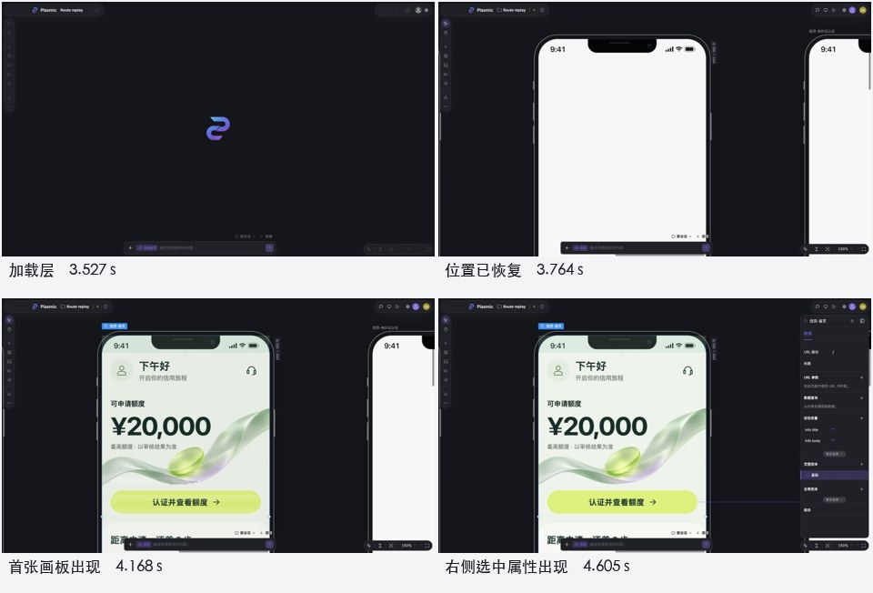

# 复开项目时恢复缩放、位置与首张画板上屏

Apple M4，Electron 生产构建，编辑器 WebContents 的 CPU 降速 4 倍。使用同一普通项目的接口回放，从列表进入编辑器，主接口固定额外等待 1 秒。项目有 33 个页面，初始画布有 9 张画板。先在编辑器将缩放从约 40% 调到 150%，平移到目标位置，正常返回列表保存。各组从这份保存状态开始，每个进程连续复开三次。

两批各有独立的现有版本对照，单个版本每批六次，交错运行。第二批将窗口内容区固定为保存时的 1512 × 890，以命中布局匹配的分支。两批的系统负载有波动，速度比较只使用同批对照。

## 实际窗口首帧

从项目列表点击起计时，在 Electron 交付的合成画面中识别目标画板。另行录下整段画面，核验识别到的首帧和后续位置。表内单位为毫秒。

| 同批方案 | 六次点击到首张画板上屏 | 中位数 | 同批变化 |
| --- | --- | ---: | ---: |
| 现有实现 | 5535、5528、5654、5596、5506、5503 | 5532 | 基准 |
| 写入后直接继续 | 5518、5721、5659、5695、5596、5557 | 5628 | +96 |
| 现有实现（同批复测） | 4818、4811、5082、5289、4983、4942 | 4962 | 基准 |
| 布局相符时直接写入 | 5053、4845、5099、4890、4799、4806 | 4868 | -95 |

## 恢复时间花在哪里

每列为同组中位数，单位为毫秒。“恢复到就绪”从目标画板上下文就绪开始，到布局等待、视口提交、目标首次渲染三个条件全部完成为止。画板在等待布局期间可以同时渲染。现有版的“视口提交”包括写入后等待下一帧或定时器的时长。

| 方案 | 等布局 | 视口提交 | 还需等目标渲染 | 恢复到就绪 | 点击到编辑器发出显示信号 | 信号到顶层窗口就绪日志 | 顶层就绪到首帧 |
| --- | ---: | ---: | ---: | ---: | ---: | ---: | ---: |
| 现有实现 | 234 | 443 | 1 | 675 | 5365 | 141 | 25 |
| 写入后直接继续 | 236 | 20 | 54 | 310 | 5084 | 507 | 22 |
| 现有实现（同批复测） | 193 | 361 | 0 | 548 | 4820 | 123 | 19 |
| 布局相符时直接写入 | 0 | 16 | 254 | 270 | 4402 | 403 | 32 |

第二批按每组三次分别取中位数，第一组现有版 4818 ms、提前写入版 5053 ms，第二组现有版 4983 ms、提前写入版 4806 ms。两组方向相反。

仅取消写入后的等待时，单独关闭画面采集、每版各六次的对照中，编辑器的显示信号从 5225 ms 提前至 4788 ms。这个 437 ms 只对应编辑器的埋点。窗口采集显示，从该信号到顶层就绪的时间也随之变化。各阶段中位数独立计算。

## 首帧位置

退出时记录的板内视口左上角为 (349.8984375, 130) CSS 像素，尺寸为 585 × 1266 CSS 像素。逐帧比对合成画面中的目标内容与退出前的截图，同时逐动画帧读取实际 DOM 坐标、CSS 缩放和滚动偏移。每个版本独立录制两次，每次持续观察约五秒。

| 录制版本 | 动画帧样本数 | 可辨认目标的窗口帧数 | 首帧后未匹配窗口帧 | 最大 DOM 坐标变化 |
| --- | ---: | ---: | ---: | ---: |
| 现有实现 | 378 | 55 | 0 | 0.0 CSS px |
| 写入后直接继续 | 375 | 57 | 0 | 0.0 CSS px |
| 布局相符时直接写入 | 711 | 51 | 0 | 0.0 CSS px |

本轮两种提前恢复方式都没有测出稳定的实际首屏提速，保留现有的恢复逻辑。下一处可独立测量的是从编辑器发出显示信号，到顶层窗口收到通知并提交加载层状态更新之间的主线程工作。

## 显示信号发出后，主线程在做什么

沿用上述项目、保存位置、接口延迟和 4 倍 CPU 降速。对比现有版本和“写入后直接继续”的实验版本。每版复开三次记录窗口首帧，再各复开两次采集 Chromium 主线程 trace 和 V8 采样栈。两种测量分开统计。先前的 141 / 507 ms 截止于 Desktop 顶层就绪日志，本次直接在窗口消息分发、顶层 React 就绪、加载层获得隐藏样式时记录时间，再用 Electron 合成帧识别目标画板。十次命中的首帧均与保存位置的目标内容对齐。

| 无 CPU 采样的三次复开，各列独立取中位数 | 现有版本 | 提前发信号 |
| --- | ---: | ---: |
| 点击 → 编辑器发出显示信号 | 4462 ms | 4316 ms |
| 发信号 → 顶层开始分发就绪消息 | 51 ms | 335 ms |
| 消息分发 → 顶层 React 标记就绪 | 18 ms | 24 ms |
| 顶层标记就绪 → 观察到加载层隐藏样式 | 20 ms | 23 ms |
| 隐藏样式 → 捕获到第一张画板 | 87 ms | 67 ms |
| 点击 → 窗口首帧，三次原始值 | 4621 / 4633 / 4738 ms | 4767 / 4827 / 4709 ms |
| **点击 → 窗口首帧中位数** | **4633 ms** | **4767 ms** |

提前版三次从发信号到消息分发分别为 337、82、335 ms。调度次序存在波动。窗口帧的时间取合成帧回调开始时刻，先记录时间再做像素识别。重型 trace 仅用于定位阻塞任务。

| trace 观察，以各次编辑器发出显示信号为 0 ms | 现有版第 1 次 | 现有版第 2 次 | 提前版第 1 次 | 提前版第 2 次 |
| --- | ---: | ---: | ---: | ---: |
| 属性面板选中状态更新任务的起止 | −363 至 −23 ms | −356 至 −23 ms | +18 至 +453 ms | +84 至 +481 ms |
| 更新任务总长 | 341 ms | 333 ms | 435 ms | 397 ms |
| 其中 React 同步渲染（采样栈估算） | 200 ms | 194 ms | 261 ms | 245 ms |
| 其中画布标签位置测量（采样栈估算） | 56 ms | 55 ms | 71 ms | 63 ms |
| 顶层开始分发就绪消息 | +62 ms | +60 ms | +543 ms | +529 ms |

编辑器 Host 与顶层页面在四次 trace 中都运行在同一条渲染主线程上。恢复画板焦点会调用 `scheduleInspectorSelection()`，安排动画帧，再用零延时定时器发布右侧属性面板的选中状态。四次 trace 都将同一个定时器回调映射到了该函数。回调本身不到 2 ms，随后 React 在同一任务中同步处理订阅更新。采样栈包括属性行、分区和弹层容器。React 提交期间，`useTagPlacement().measure()` 读取选中标签、iframe 和工具栏的 DOM 几何信息，触发样式计算与布局。提前版这项任务内的样式重算与布局共 72–78 ms，与测量调用存在重叠。第二张画板的初始化在这项任务之后才开始。[选中状态发布](../../../platform/wab/src/wab/client/studio-ctx/StudioCtx.tsx) · [画布标签测量](../../../platform/wab/src/wab/client/components/canvas/HoverBox/useTagPlacement.tsx)

已有有效保存视图时，编辑器先选中目标画板并关闭自动居中。目标画板建立上下文后，布局等待与画板渲染可以同时进行。编辑器在加载层下写入保存的缩放和平移量，并补偿画布留白的变化。视口恢复且目标画板首次渲染完成后，编辑器才请求顶层显示画布。此次现有版的两条 trace 里，首张画板内部渲染完成约 110 ms 后开始写入视口，此时用户仍看到加载层。正常首开没有保存位置时才采用适配画布的初始缩放。[初始路由和视口](../../../platform/wab/src/wab/client/studio-ctx/StudioCtx.tsx) · [顶层加载状态](../../../platform/wab/src/wab/client/components/studio/StudioChrome.tsx)

## 首次布局时恢复保存的视图

本轮实现先确定保存的目标画板。在画布容器首次取得实际尺寸时，同步写入缩放和滚动位置，并按当前窗口的画布留白补偿坐标。目标画板首次渲染完成就满足原有的显示条件。右侧面板沿用原有的选中恢复流程。

沿用上面的生产构建、项目和接口回放。在 1512 × 890 窗口中，从列表点击进入，编辑器 CPU 降速 4 倍。每组复开两次，改前和改后的组按旧、新、新、旧、旧、新交错运行，各得到六次结果。下表的每一行独立取中位数。另行录制全程合成帧以验证位置，录制耗时未计入表中。

| 同一普通项目复开 | 改前 | 改后 |
| --- | ---: | ---: |
| 目标画板首次渲染完成 → 编辑器发出显示信号 | 450 ms | 76 ms |
| 点击 → 编辑器发出显示信号 | 4664.5 ms | 4373.1 ms |
| 发信号 → 顶层开始分发就绪消息 | 53 ms | 357 ms |
| 点击 → 顶层开始隐藏加载层 | 4758 ms | 4772 ms |
| **点击 → 窗口出现目标画板** | **4810 ms** | **4816 ms** |
| 六次实际窗口首帧，单位 ms | 4935、4984、4830、4790、4664、4699 | 4937、5000、4929、4703、4631、4632 |

按取整前的中位数计算，显示信号提前 291 ms，顶层消息等待增加 304 ms，实际画板上屏晚 6 ms。两组实际首帧的取值范围大幅重叠。上节的主线程采样已观察到选中状态更新会占用这一时段，本轮计时未再开启 CPU 采样。

六次新版均在目标画板开始加载前 28–37 ms 写完保存视图，早于开始首次渲染 453–555 ms。新旧两版的 12 张计时首帧都与退出前的目标画板图像匹配，每张匹配到 203 个特征点。新版在原窗口尺寸下的目标画板左上角为 (349.90, 130.00) CSS px，缩放为 150%，与保存前一致。

另录新版同尺寸复开两次、缩小窗口复开一次。逐帧对照退出前的画板内容，同时采样 DOM 中的画板位置、大小、缩放和滚动量。缩小窗口的滚动量按实际画布留白换算。

| 重开时窗口 | 目标出现后连续匹配的合成帧 | 首帧后丢失目标的帧 | 与保存位置的最大 DOM 偏差 | 缩放 |
| --- | ---: | ---: | ---: | ---: |
| 1512 × 890，两次 | 24、25 | 0 | 0 CSS px | 150% |
| 1323 × 800，一次 | 20 | 0 | 0.055 CSS px | 150% |

缩小窗口时，首帧画板左上角为 (349.84, 130.00) CSS px。三次录制均从加载层直接显示已定位的画板，随后约 2.3 秒的合成帧中目标持续可见。缩放和位置可以先就绪，顶层仍须等目标画板完成首次渲染才能安全撤掉加载层。

## 顶层撤层与右侧选中状态恢复的先后顺序

以已经提前定位画布的版本为对照。上一组中位数 357 ms 从编辑器发出显示通知开始，到顶层消息分发开始为止。在同一生产构建上另录两条 Chromium 主线程 trace 和 V8 CPU 样本，Host 和顶层通知均落在同一渲染进程的同一线程。表中的零点是 Host 的显示通知。

| 事件，单位 ms | 第一次 | 第二次 |
| --- | ---: | ---: |
| 右侧选中状态发布任务开始 | +50 | +50 |
| 任务结束 | +477 | +472 |
| 其中 React 调度回调持续时间 | 419 | 416 |
| 其中画布选中标签几何测量的 CPU 采样估算 | 69 | 73 |
| 顶层开始分发就绪消息 | +521 | +518 |
| 顶层开始隐藏加载层 | +598 | +597 |

定时器源映射指向 `scheduleInspectorSelection()`。发布选中状态本身不到 1 ms，随后订阅更新触发 React 同步渲染和提交。选中标签在提交时测量画布几何信息，这段时间包含在任务总耗时内。独立 trace 的采样开销会延长任务，两条 trace 用来定位调用栈，实际打开速度另行测量。

新版在保存的视图定位完成后撤掉顶层和画布的全局加载层，继续渲染画板。右侧属性在目标首次渲染完成并给浏览器一次绘制机会后，读取当时的选中对象。由此仍能处理首屏期间用户改变选中的情况。首次打开、无效保存记录和预览沿用各自的加载条件。

独立录制的两次复开，首张目标内容分别出现在点击后 4168 和 4114 ms，右侧属性分别再晚 437 和 454 ms 出现。目标出现后的 28 和 31 张合成帧均持续匹配保存前的业务内容，391 个动画帧样本中位置和缩放的最大偏差为零。提前撤层后先显示设备外框，内部是待渲染的白色区域。

三种生产构建使用同一 33 页、9 张画板的普通项目、同一份 150% 保存视图、相同接口回放和 4 倍 CPU 降速。每组从列表复开两次，各版本共六次。新旧组交错运行。加载层取顶层应用隐藏样式的时刻，画板和属性面板分别在窗口合成图像中匹配目标内容与属性行。各列独立取中位数。

| 方案 | 点击 → 顶层开始撤层 | 点击 → 目标画板内容 | 点击 → 右侧选中属性 | 撤层 → 目标内容 | 目标内容 → 右侧属性 |
| --- | ---: | ---: | ---: | ---: | ---: |
| 当前对照 | 4636 ms | 4712 ms | 4712 ms | 75 ms | 0 ms |
| 延后选中属性，等目标渲染再撤层 | 4480 ms | 4823 ms | 4823 ms | 332 ms | 0 ms |
| 延后选中属性，视图定位即撤层 | 3604 ms | 4214 ms | 4664 ms | 617 ms | 446 ms |

| 方案 | 六次点击到首张目标画板，单位 ms |
| --- | --- |
| 当前对照 | 5554、5707、4565、4582、4764、4659 |
| 延后选中属性，等目标渲染再撤层 | 5589、5652、4535、4585、4669、4977 |
| 延后选中属性，视图定位即撤层 | 4218、4166、4210、4201、4308、4270 |

与同批对照相比，新版顶层撤层提前约 1.03 秒，首张目标内容提前约 498 ms，六次都先于属性面板上屏。仅延后发布选中属性、仍等目标渲染才通知顶层时，六次的第一张目标画面都已经带有属性面板。18 张计时首帧均与保存前的目标内容做了图像特征比对。以上数值针对本机的同一项目，三组逐次耗时反映了运行负载波动。

## 撤掉加载层后，首张画板还在做什么

沿用同一普通项目、保存目标、150% 缩放、生产 Electron 和 4 倍 CPU 降速。零点取顶层加载层开始隐藏，终点取窗口合成帧首次匹配目标画板业务内容。原实现复开四次得到 615、588、584、605 ms，中位数 597 ms。上节的六次中位数为 617 ms。每次撤层时，目标画板的 iframe 都已经开始初始化，Host HTML 都已加载完成。

| 原实现，四次逐段中位数 | 耗时 |
| --- | ---: |
| 撤层 → iframe 的 Host 内容挂载点就绪 | 44 ms |
| 安装画板基础运行时和 React Web | 33 ms |
| 从目标画板、全局上下文和项目依赖确定所需组件库 | 32 ms |
| 取得并在 iframe 注册组件库 | 89 ms |
| 完成画布上下文初始化，到首次求值开始 | 48 ms |
| 首次求值开始 → 窗口出现业务内容 | 350 ms |

另做只加起止计时的生产构建，复开四次，总中位数 596 ms。首张业务组件树的 React 同步渲染和提交（`flushSync`）本身用 184 ms；同步提交返回后到窗口捕获首张画面还有 159 ms。组件库阶段中，单独执行 Material UI 1.1.0 注册脚本用 73 ms。各列独立取中位数。首屏图片也在加载，本次目标内容已上屏时仍能观察到图片请求完成事件。

两次独立的 Chromium trace 将窗口、Host 和目标画板对齐。在 751 和 712 ms 的观察区间内，渲染主线程分别有 748 和 710 ms 处在任务中。画板首次同步渲染调用栈包含节点渲染、React 提交及维护节点与 DOM 对应关系的编辑器钩子。随后 Studio 自身还有一段 132 / 122 ms 的 React 回调，V8 采样中约 63 / 58 ms 落在画布选中框、间距计算和标签测量。回调结束后还要经过浏览器布局、绘制与合成帧交付，部分后续任务与合成重叠。本次无采样的四轮，右侧属性都在目标内容上屏 415–503 ms 之后出现，其他画板的初始化也在目标上屏之后开始。采样用于归因，计时用未开启 CPU 采样的轮次。

目标路由已经确定到目标 iframe 开始初始化，本轮有 175–192 ms 的间隔。目标 iframe 的实际启动已比撤层早 188–195 ms。组件依赖的扫描可以在目标模型确定后开始。基础运行时和 React Web 的源码已经预取；同版本 Material UI 的资源在撤层前已有一次读取，普通复开的第二次资源读取为 6–16 ms。脚本执行依赖目标 Document 及其宿主运行时。提前这部分工作需要提早启动最终显示的目标 iframe，并保持同一个 Document。首张业务树依赖 iframe、组件注册、样式和画板上下文。选中框的真实几何尺寸依赖已经提交的 DOM，可以单独验证把间距和标签测量推迟到业务首帧之后的效果。

### 将依赖扫描提到加载期间的对照实验

只在独立诊断构建中，把目标画板的同一次依赖扫描移到 iframe 初始化开头，在等待 Host 挂载点期间保留结果；组件库脚本仍在原来的目标 Document 中注册。其余画板使用原流程。按对照、实验、实验、对照的顺序，每组复开两次。

| 四次中位数 | 对照 | 提前扫描 |
| --- | ---: | ---: |
| 点击 → 顶层开始撤层 | 3650 ms | 3755 ms |
| 撤层 → 首张业务内容 | 596 ms | 598 ms |
| 点击 → 首张业务内容 | 4259 ms | 4353 ms |

四次扫描都在撤层前完成，分别提前 136、32、56、61 ms。此次移动没有测出首帧收益。点击到上屏的逐次值对照为 4176、4212、4331、4305 ms，实验为 4208、4385、4321、4674 ms。当前应用仍使用原有扫描位置。本节共 18 次复开的首张合成画面都与保存前的目标内容做了图像特征核对。

## 目标画板确定时就启动同一个 iframe

本次实验基于保存位置和缩放后即可撤层、右侧属性在首张内容后恢复的版本。对照和实验都在初始路由确认已保存的画板时记录时间，在写入 iframe 的真实宿主文档时再次记录。实验版在选定画板时创建目标 iframe，用正常的宿主 HTML 和目标画板参数启动。在画布挂载时用 Electron 支持的 DOM 状态保留移动把原 iframe 接入画板。每次都检查接入前后的 Window 和 Document 身份、宿主写入次数，以及撤层前已经完成接入。沿用同一套画板运行时、组件注册和选中框逻辑。

正式对照把目标 iframe 放在当前可视区域内，由原有顶层加载层遮挡。使用同一 33 页、9 张画板的普通项目、同一份 150% 保存视图、相同生产构建配置和额外 1 秒的接口回放延迟。编辑器 CPU 降速 4 倍。每组从列表点击复开两次，按对照、实验、实验、对照、对照、实验交错运行。首张业务内容以 Electron 窗口合成帧匹配保存画板为准。录帧和 CPU 采样另行运行。

| 各阶段中位数 | 对照 | 提前启动 | 实验减对照 |
| --- | ---: | ---: | ---: |
| 点击 → 首张业务内容上屏 | 4823 ms | 4739 ms | -84 ms |
| 顶层开始撤层 → 首张业务内容上屏 | 694 ms | 687 ms | -7 ms |
| 点击 → 顶层开始撤层 | 4118 ms | 4044 ms | -73 ms |
| 确定目标 → 写入目标宿主文档 | 248 ms | 14 ms | -234 ms |
| 确定目标 → 目标宿主 client JS 读取完成 | 269 ms | 31 ms | -238 ms |
| 确定目标 → 宿主内容挂载点就绪 | 533 ms | 518 ms | -16 ms |
| 确定目标 → 目标画板上下文创建 | 769 ms | 748 ms | -21 ms |

| 六次复开，单位 ms | 点击到首张内容 | 撤层到首张内容 |
| --- | --- | --- |
| 对照 | 4910、4829、4807、4769、4816、4852 | 801、675、692、671、696、697 |
| 提前启动 | 4748、4780、4701、4779、4727、4730 | 689、740、671、714、683、685 |

以每两次复开的中位数比较，三对实验的点击到首帧分别缩短 105、48、106 ms。撤层到上屏分别缩短 24 ms、增加 11 ms、缩短 12 ms。这次点击到首帧的收益主要出现在撤层前。阶段中位数分别计算，不能直接相加。另将同一 iframe 放在屏外启动，两版各复开六次，点击到首帧的中位数为 4755 / 4839 ms，撤层到首帧为 696 / 710 ms。

同一批次中，虽然宿主 JS 读取提前 238 ms，从确定目标到宿主 Document 加载完成仍用了 355 / 359 ms。单独采集的实验版 CPU trace 显示，写入文档后的前 288 ms 主要花在 Studio 的 React 渲染、提交和布局上，调用栈包括画板标题、Copilot 活动提示和初始视口布局。宿主 client 脚本到第 355 ms 才开始执行。对照 trace 中该脚本在写入后第 71 ms 开始执行。提早创建 iframe 能与这些任务重叠读取资源，但脚本执行仍需等同一条渲染主线程。按六次中位数，到画板上下文可用时，只保留了 21 ms 的提前量。

12 次正式计时的首张业务画面均匹配退出前的画板。另用原窗口（1512 × 890）录制两次，用缩小的窗口（1323 × 800）复开一次，业务内容首次出现后的连续 32、35、26 张窗口画面均匹配。三次分别采到 205、206、199 个动画帧，从撤层前到面板恢复后，目标画板的位置和 150% 缩放在各次内部均无变化。原窗口与保存位置完全相同，缩窗后的横坐标和预期相差 0.055 CSS px。下图时间来自单独的录帧轮次。

## 全部画板完成后恢复选中和右侧属性

同一 33 页、9 张画板的普通项目，保存缩放 150%，编辑器 CPU 降速 4 倍，接口回放增加 1 秒延迟。连续从列表复开三次。计时从点击开始，首张业务内容和右侧选中属性用 Electron 窗口合成帧判定，全部画板完成取第 9 张首次渲染完成标记。选中恢复取两层动画帧和零延时定时器回调中发布画板焦点及属性后的标记。

| 从点击开始，单位 ms | 第一次 | 第二次 | 第三次 |
| --- | ---: | ---: | ---: |
| 首张业务内容上屏 | 4165 | 4050 | 4073 |
| 9 张全部完成首次渲染 | 8015 | 8036 | 7873 |
| 恢复选中并发布属性 | 8072 | 8085 | 7918 |
| 右侧属性实际可见 | 8668 | 8646 | 8466 |

三次均验证，首张就绪、其他画板还在加载时，目标 UUID 与保存记录一致，实际选中和属性面板选中仍为空。全部画板完成后经过 45–57 ms 恢复选中，最终选中与右侧属性均指向原目标。三张业务首帧分别匹配退出前窗口截图的 208 个特征点，画板位置与 150% 缩放一致。本轮测量验证恢复顺序，未进行改前改后交错计时。

## 延后选中恢复的改前改后交错对照

对照版本在初始路由恢复画板焦点，目标首次渲染后发布右侧选中属性。改后版本保留目标画板的加载优先级，把选中和属性恢复推迟到当前画布的初始画板完成后，并允许屏外画板在后台完成第一次渲染。两版均使用原有 iframe 启动方式。

同一台 M4、同一项目的 33 页与 9 张初始画板、相同的 Electron 生产构建配置、1512 × 890 窗口和同一份接口回放，项目主接口固定额外等待 1 秒，编辑器 WebContents 的 CPU 降速 4 倍。分别保存 150% 局部视图、通过编辑器“缩放至适合”得到的 39.61% 全景视图，两种视图选中同一张画板。每个视图按旧、新、新、旧、旧、新的顺序分组，每组从相同保存状态启动一个独立测试配置，从列表复开两次，每版六次。测试期间保持视图静止。

首帧取窗口合成图像首次匹配目标画板业务内容的时刻，首帧截图再与同一视图的参照图做特征点核验。撤层起点是顶层 loading 加入淡出样式的时刻。全部完成取最后一张画板首次渲染完成的标记，并核对 9 个画板上下文的状态。

| 保存视图 | 耗时中位数 | 改前 | 改后 | 改后节省 |
| --- | --- | ---: | ---: | ---: |
| 150% | 点击至首张业务内容上屏 | 4193 ms | 4079 ms | 114 ms |
| 150% | 撤层至首张业务内容上屏 | 601 ms | 526 ms | 76 ms |
| 150% | 点击至 9 张全部完成首次渲染 | 24 秒观察期内 2/9 | 7626 ms | 无法计算 |
| 39.61% | 点击至首张业务内容上屏 | 4086 ms | 3992 ms | 94 ms |
| 39.61% | 撤层至首张业务内容上屏 | 599 ms | 497 ms | 102 ms |
| 39.61% | 点击至 9 张全部完成首次渲染 | 8453 ms | 7807 ms | 646 ms |

150% 视图的六次改前复开均停留到点击后至少 24 秒。每次都已建立 9 个画板上下文，2 张视口内画板完成首渲染，7 张屏外画板的求值队列暂停。改后六次均完成 9 张的首次渲染。全景视图中两版都看得到全部 9 张画板，可直接比较总耗时。

| 视图 | 版本 | 点击至首张（ms） | 撤层至首张（ms） | 点击至 9 张完成（ms） |
| --- | --- | --- | --- | --- |
| 150% | 改前 | 4328、4167、4052、4219、4253、4098 | 566、596、599、610、674、604 | 6 次均为 2/9 |
| 150% | 改后 | 4034、4041、4117、4007、4155、4171 | 555、520、513、501、572、531 | 7934、7589、7612、7575、7641、7639 |
| 39.61% | 改前 | 4152、4082、4061、4073、4129、4091 | 640、576、584、613、618、566 | 8483、8402、8366、8466、8440、8532 |
| 39.61% | 改后 | 4077、3976、3965、3954、4025、4008 | 471、503、505、516、490、492 | 8017、7732、7707、7662、7928、7882 |

24 张首帧截图全部匹配各自保存视图中的目标业务内容。150% 局部视图每张至少匹配 218 个特征点，全景视图每张至少匹配 33 个。全景视图六对复开的 9 张总耗时均缩短，分别节省 466、671、659、803、512、650 ms。新版在全部渲染后才恢复右侧选中属性，此处的总耗时截止于画板渲染完成。

## 保留屏外按需渲染，只等视口内画板恢复选中

同一 33 页项目、9 张初始画板、150% 保存视图，窗口 1512 × 890，可见 2 张。编辑器 WebContents 的 CPU 降速 4 倍，接口回放固定多等 1 秒。沿用同一构建配置，每组从列表复开两次，按等全部、只等可见、只等可见、等全部、等全部、只等可见交错测试。两版都用两次动画帧和零延时定时器恢复选中。首张和右侧属性分别以 Electron 窗口合成帧里业务内容、属性行实际出现为准，12 次均用截图核验。

| 各次耗时的中位数 | 等全部 9 张 | 只等可见 2 张 |
| --- | ---: | ---: |
| 点击 → 首张业务内容上屏 | 4252 ms | 4260 ms |
| 开始撤 loading → 首张上屏 | 549 ms | 556 ms |
| 点击 → 可见画板均完成首次渲染 | 5006 ms | 4986 ms |
| 点击 → 恢复选中并发布属性 | 8242 ms | 5029 ms |
| 点击 → 右侧属性上屏 | 8800 ms | 5588 ms |
| 首张上屏 → 右侧属性上屏 | 4509 ms | 1310 ms |

| 六次复开，单位 ms | 点击至首张业务内容 | 点击至右侧属性 |
| --- | --- | --- |
| 等全部 | 4393、4189、4216、4287、4810、4204 | 8986、8871、8713、8729、9093、8726 |
| 只等可见 | 4445、4221、4403、4297、4206、4222 | 5756、5481、5712、5574、5553、5603 |

新版六次都是 2 张可见画板完成首渲染后才发布焦点和属性。在 9 个上下文均建好、面板已上屏后，另外 7 张的渲染队列仍暂停，均未完成首次业务渲染。最后一次复开在取完计时和队列状态后保持缩放不变，将一张尚未渲染的屏外画板移入视口，验证它自动完成首渲染。六对复开的右侧属性分别提前 3230、3391、3001、3154、3540、3123 ms。

## 屏外画板按需创建 iframe 和 ViewCtx 的交错对照

使用 33 页、9 张画板的同一普通项目和 150% 保存视图，窗口 1512 × 890，初始可见 2 张。两版均在可见画板就绪后，经两次动画帧和零延时定时器恢复选中与右侧属性。对照版后台建立 9 个 iframe 和 ViewCtx，屏外业务渲染暂停。隔离实验版先保留画板外框，以外框与画布视口的实际交叉触发创建，启动目标仍有优先权；创建后保留实例。

Apple M4，Electron 生产构建配置，编辑器 CPU 降速 4 倍，项目主接口沿用额外 1 秒的回放延迟。每项测试按对照、实验、实验、对照、对照、实验分组，每组从列表复开两次。每次进入时使用同一个保存位置。保持缩放不变，向左平移 945 CSS px，刚好让相邻的「登录」成为这次打开后第 3 张可见过的画板。时间从列表点击或发出平移指令开始，终点为 Electron 窗口合成图像匹配目标业务内容或右侧属性行。首张、面板和第 3 张共 36 张截图均独立比对了参照图的特征点。

内存另跑一轮相同的交错顺序，关闭窗口截图采集。使用 macOS 每个 Electron 进程的物理内存占用（physical footprint），计入桌面应用主进程、编辑器渲染进程、GPU 及其他子进程。记录列表点击前、点击后 16 秒保持原位、平移后 6 秒三个采样点，没有手动调用 GC。时间与内存各版本分别取六次复开的中位数。

| 指标 | 当前方案 | 延后创建 | 实验减对照 |
| --- | ---: | ---: | ---: |
| 点击 → 首张画板上屏 | 4118 ms | 4125 ms | +8 ms |
| 点击 → 右侧属性上屏 | 5394 ms | 5397 ms | +3 ms |
| 平移 → 第 3 张业务内容上屏 | 404 ms | 548 ms | +144 ms |
| 初始视图，整套应用 | 1115 MiB | 990 MiB | -124 MiB |
| 初始视图，编辑器渲染进程 | 515 MiB | 405 MiB | -110 MiB |
| 初始视图，整套应用相对本次列表的增量 | 721 MiB | 598 MiB | -123 MiB |
| 平移后，整套应用 | 1085 MiB | 1000 MiB | -85 MiB |
| 平移后，编辑器渲染进程 | 523 MiB | 433 MiB | -91 MiB |

| 六次复开，按各版本的执行顺序 | 当前方案 | 延后创建 |
| --- | --- | --- |
| 点击 → 首张画板上屏（ms） | 4129、4107、4129、4084、4047、4209 | 4086、4303、4175、4049、4164、4083 |
| 点击 → 右侧属性上屏（ms） | 5445、5341、5487、5354、5331、5434 | 5315、5555、5415、5379、5459、5344 |
| 平移 → 第 3 张业务内容上屏（ms） | 422、408、415、399、398、355 | 547、542、589、549、544、616 |
| 初始视图，整套应用（MiB） | 1138、1097、1133、1096、1138、1076 | 1074、984、997、957、1010、955 |
| 初始视图，编辑器渲染进程（MiB） | 515、515、515、514、512、512 | 405、405、404、404、404、405 |

平移前，两版都只有 2 张完成业务首渲染，iframe 和 ViewCtx 的数量分别是 9 和 2。平移后分别是 9 和 3，业务首渲染数均为 3。实验版每次都是在平移之后才开始第三张 iframe 的宿主加载、创建 ViewCtx。该轮覆盖的是启动及首次进入一张相邻屏外画板，未测试遍历多张画板、导出或后台工具调用。

按每组相同复开次序配对，六次延后创建的平移上屏分别多用 125、134、174、149、146、260 ms。首张和右侧属性的差值在不同轮次中有快有慢。
